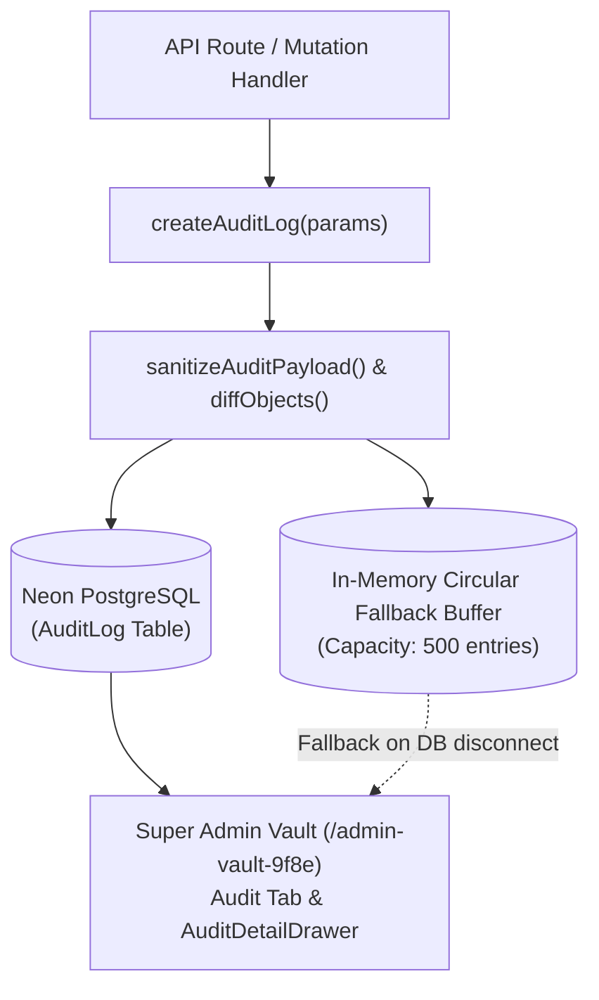

# Comprehensive Audit Logging & Forensic Standard

**Version:** 1.0.0  
**Status:** Mandatory System Policy & Engineering Directive  
**Effective Date:** 2026-10-12  
**Target Audience:** All Software Engineers, DevOps Engineers, and AI Development Agents working on Retzlo.

---

## 1. Executive Summary & Purpose

In order to protect system integrity, defend against unauthorized access, provide clear accountability for administrative actions, and facilitate debugging of production anomalies without infringing upon user privacy, this repository enforces an **enterprise-grade, legally compliant, append-only Audit Logging Engine**.

> [!IMPORTANT]
> **Mandatory Rule for All Future Features & Routes:**  
> Any new or modified mutation endpoint (Create, Update, Delete), financial/coin transaction, permission change, AI quota alteration, or security-sensitive access **MUST instrument an audit log entry via `createAuditLog()`**. Failure to include audit logging on auditable state changes is a build and review violation.

---

## 2. Legal Foundations & Regulatory Compliance

Retzlo operates under strict compliance with domestic and international data privacy and cybercrime legislation:

### 2.1. Thailand Personal Data Protection Act (PDPA B.E. 2562)
- **Section 24(5) (Legitimate Interests):**  
  Processing of operational audit logs is lawful without explicit per-event consent because it is necessary for the legitimate interests of the data controller (preventing cybersecurity intrusions, detecting fraudulent token/coin tampering, and ensuring continuous platform stability), balanced against the rights of data subjects through rigorous data minimization.
- **Section 28 & Privacy by Design:**  
  Audit logging adheres to strict **Data Minimization**. Only operational metadata is preserved; personal private diaries, emotional reflections, note bodies, and passwords are strictly excluded.

### 2.2. Thailand Computer Crime Act (B.E. 2550 & B.E. 2560 Amendment)
- **Section 26 (Mandatory Traffic & Access Data Retention):**  
  Platform service providers are legally obligated to store Computer Traffic Data (`actorId`, `ipAddress`, `userAgent`, `requestPath`, `requestMethod`, and precise UTC timestamp) for **no less than 90 days** from the date of system access to assist legal and regulatory investigations.
- **Clock Synchronization:** All audit timestamps are recorded in coordinated universal time (UTC) derived from reliable synchronized time servers.

### 2.3. EU General Data Protection Regulation (GDPR)
- **Article 6(1)(f) (Legitimate Interests):** Essential forensic telemetry for system security, fraud deterrence, and disaster recovery.
- **Article 32 (Security of Processing):** Redaction mechanisms prevent credential exposure even if audit tables are inspected.

---

## 3. Strict Zero-PII & Secret Sanitization Rules

To ensure full compliance with privacy legislation and eliminate the risk of credential leakage, the following data **MUST NEVER BE LOGGED**:

| Category | Strictly Prohibited in Logs | Compliant Alternative |
| :--- | :--- | :--- |
| **Passwords & Credentials** | Plaintext passwords, password hashes, salts | Only log event: `PASSWORD_RESET_COMPLETED`, no credential payload |
| **Auth Tokens & Secrets** | JWT bearer tokens, session cookies, API secret keys, OTP codes | Masked to `[REDACTED]` or `[REDACTED_JWT_TOKEN]` automatically |
| **Financial / Payment** | Credit card numbers, CVVs, bank account credentials | Only record internal coin amounts and transaction IDs |
| **User Private Notes / Diaries**| Full markdown text, private personal journal entries, emotional reflections | Only log metadata: `{ title, wordCount, folderId }` or `{ habitTitle, completed }` |
| **Large Text Blobs** | Any unstructured text exceeding 1,000 characters | Automatically truncated with `[TRUNCATED_TEXT, length: N]` |

The engine's `sanitizeAuditPayload()` automatically scans keys matching `/password|pass|hash|token|secret|otp|auth|credential|cookie|creditcard|cvv|privatekey/i` and redacts them recursively. However, engineers and AI agents must design payloads with data minimization from the outset.

---

## 4. Architecture & Persistence Model

The Audit Log system implements a **Dual-Persistence Resilient Architecture**:



1. **Primary Persistence:** Neon PostgreSQL `AuditLog` table with 6 compound B-tree indexes (`timestamp(sort: Desc)`, `actorId`, `[category, action]`, `[targetType, targetId]`, `severity`, `status`).
2. **Fallback Circular Buffer:** If database connectivity is momentarily lost during cold starts or network partitions, records are buffered in memory and surfaced seamlessly in the admin explorer.
3. **Immutability:** Audit records are strictly **append-only**. There are no `UPDATE` or `DELETE` API routes or UI controls for audit logs.

---

## 5. Standard Event Taxonomy

Every event must be categorized using the standard enum sets:

### 5.1. Categories (`AuditCategory`)
- `AUTH`: Sign in, registration, password reset, OTP verification, session revocation.
- `USER`: Profile updates, role promotions/demotions, account suspensions, coin adjustments.
- `PROJECT`: Workspace creation, deletion, renaming, transfer of ownership, member changes.
- `BOARD`: Kanban board creation, column restructuring, card reordering.
- `CARD`: Card status changes, assignments, archive, attachment removal.
- `REWARDS`: Reward creation, store purchases, redemption approvals/rejections.
- `FINANCE`: Coin transactions, refunds, balance reconciliations.
- `AI`: Quota allocation, tier upgrades, credit limits.
- `SECURITY`: Honeypot hits, rate limit trips, unauthorized vault access attempts.
- `SYSTEM`: Broadcast messages, background jobs, database maintenance, audit exports.

### 5.2. Severity Levels (`AuditSeverity`)
- `INFO`: Normal diagnostic events (e.g. routine queries, health checks).
- `NOTICE`: Successful business state mutations (e.g. new user registration, workspace creation).
- `WARNING`: Suspicious or noteworthy occurrences (e.g. honeypot trigger, user suspension, ownership transfer).
- `ERROR`: Recoverable server or operational failures (e.g. external API timeout, transaction conflict).
- `CRITICAL`: Severe system interventions or fatal faults (e.g. permanent workspace deletion, mass account purge).

### 5.3. Status (`AuditStatus`)
- `SUCCESS`: Operation was authorized and committed cleanly.
- `FAILED`: Operation failed due to error or exception.
- `DENIED`: Operation was blocked by authorization checks, rate-limiters, or security honeypots.

---

## 6. Developer Integration Guide

When adding new routes or features, follow this standardized implementation pattern:

### 6.1. Standard Mutation Example

```typescript
import { createAuditLog } from "@/lib/audit/audit-logger";

// Inside your route handler:
export async function PATCH(request: Request, { params }: { params: { id: string } }) {
  const session = await getAuthenticatedUser();
  const existingEntity = await prisma.workspace.findUnique({ where: { id: params.id } });
  
  // Extract client network metadata (CCA Section 26 compliance)
  const forwardedFor = request.headers.get("x-forwarded-for");
  const ip = forwardedFor ? forwardedFor.split(",")[0].trim() : (request.headers.get("x-real-ip") || null);
  const userAgent = request.headers.get("user-agent") || null;

  // Perform mutation
  const updatedEntity = await prisma.workspace.update({
    where: { id: params.id },
    data: updateData
  });

  // Mandatory: Trigger audit log asynchronously
  void createAuditLog({
    actorId: session.user.id,
    actorEmail: session.user.email,
    actorName: session.user.name,
    actorRole: session.user.role,
    ipAddress: ip,
    userAgent,
    requestPath: `/api/workspaces/${params.id}`,
    requestMethod: "PATCH",
    category: "PROJECT",
    action: "WORKSPACE_UPDATED",
    severity: "NOTICE",
    status: "SUCCESS",
    targetType: "WORKSPACE",
    targetId: params.id,
    targetName: updatedEntity.name,
    summary: `User ${session.user.email} updated workspace "${updatedEntity.name}"`,
    beforeState: existingEntity,
    afterState: updatedEntity,
    metadata: { modifiedFields: Object.keys(updateData) }
  });

  return NextResponse.json({ workspace: updatedEntity });
}
```

### 6.2. Error & Security Failure Example

```typescript
import { createAuditLog } from "@/lib/audit/audit-logger";

try {
  // Risky operation
} catch (error) {
  void createAuditLog({
    actorId: user?.id,
    actorEmail: user?.email,
    ipAddress: ip,
    userAgent: userAgent,
    requestPath: "/api/financial/transfer",
    requestMethod: "POST",
    category: "FINANCE",
    action: "COIN_TRANSFER_FAILED",
    severity: "ERROR",
    status: "FAILED",
    summary: `Coin transfer failed for user ${user?.email}`,
    errorMessage: error instanceof Error ? error.message : "Unknown error",
    metadata: { attemptAmount: amount }
  });
  throw error;
}
```

---

## 7. Administrative Audit Explorer & Forensics

Authorized administrators inspect audit trails via the Super Admin Vault:
- **Route:** `/admin-vault-9f8e` -> **Audit Logs & Forensics** Tab.
- **Features:**
  - Real-time 24h event counter, failure metrics, and security intrusion counter.
  - Multi-dimension filtering (Free text search, Category, Severity, Status, Date Range).
  - Quick-preset chips (`All`, `Security`, `Failures`, `User Modifications`, `AI Intelligence`).
  - Slide-over `AuditDetailDrawer` featuring side-by-side Before/After state mutation visual diffs and copyable forensic JSON.
  - Encrypted/signed CSV and JSON export capability (exports themselves generate audit logs).

---

## 8. Summary Checklist for Code Reviews

Before merging any pull request or completing an agent task, verify:
- [x] Does any new mutation route (POST, PUT, PATCH, DELETE) invoke `createAuditLog()`?
- [x] Are passwords, tokens, private note contents, or raw personal reflections completely omitted from the audit payload?
- [x] Are `ipAddress` and `userAgent` captured from request headers for CCA Section 26 compliance?
- [x] Are `beforeState` and `afterState` supplied for structural delta visualization where applicable?
- [x] Is the log entry asynchronous (`void createAuditLog(...)`) to ensure zero latency overhead on end-user requests?
