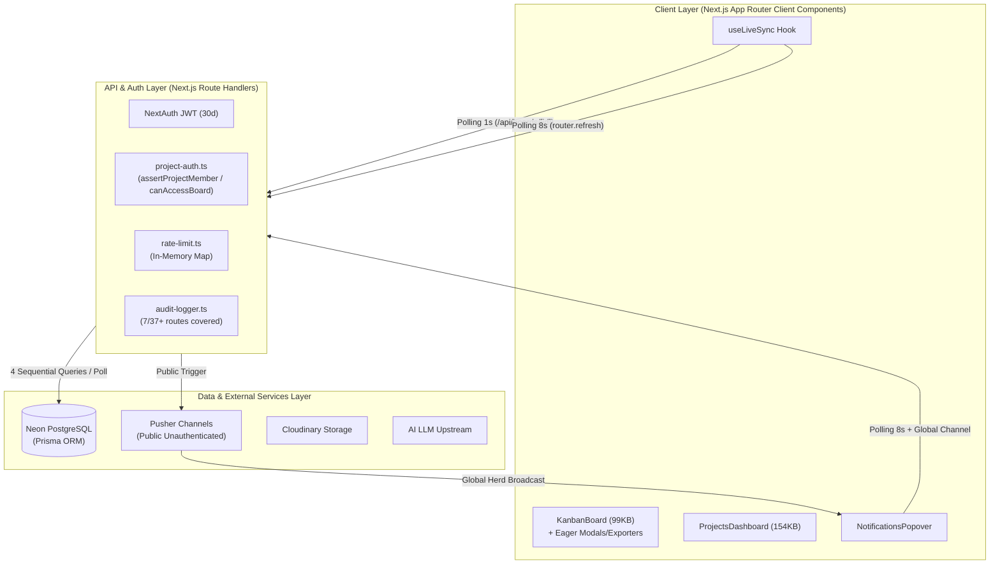

# มาตรฐานและผลการวิเคราะห์เชิงลึก: ความปลอดภัย ประสิทธิภาพ ความเร็ว และความเสถียรของระบบ (Security, Performance, Speed & Stability Architecture Standard)

**วันที่จัดทำ:** 2026-10-20  
**ขอบเขต:** ทั้งระบบ (Next.js App Router, Prisma ORM, Neon PostgreSQL, NextAuth, Pusher Real-Time, Cloudinary, AI Services)  
**วัตถุประสงค์:** วิเคราะห์ช่องโหว่ คอขวดประสิทธิภาพ และจุดเสี่ยงด้านความเสถียรของระบบในปัจจุบันแบบละเอียดระดับบรรทัดโค้ด พร้อมวางโครงสร้างสถาปัตยกรรมมาตรฐาน (Target Architecture) เพื่อรองรับการขยายตัวในอนาคต (Future Scalability & Multi-Module Expansion)

---

## สารบัญ (Table of Contents)

1. [ภาพรวมสถาปัตยกรรมและระดับความเสี่ยงปัจจุบัน (Executive Summary)](#1-ภาพรวมสถาปัตยกรรมและระดับความเสี่ยงปัจจุบัน-executive-summary)
2. [ส่วนที่ 1: การวิเคราะห์ระบบความปลอดภัยเชิงลึก (Security Audit)](#2-ส่วนที่-1-การวิเคราะห์ระบบความปลอดภัยเชิงลึก-security-audit)
   - 2.1 ช่องโหว่ระดับวิกฤต (Critical — P0)
   - 2.2 ช่องโหว่ระดับสูง (High — P1)
   - 2.3 ช่องโหว่ระดับกลางและมาตรฐานการตรวจสอบ (Medium — P2)
3. [ส่วนที่ 2: การวิเคราะห์ประสิทธิภาพและความเร็ว (Performance & Speed Audit)](#3-ส่วนที่-2-การวิเคราะห์ประสิทธิภาพและความเร็ว-performance--speed-audit)
   - 3.1 ปัญหา Real-Time Polling Storm & Network Bottlenecks
   - 3.2 ปัญหา Database Queries, N+1 และ SSR Over-Fetching
   - 3.3 ปัญหา Database Schema & Missing Composite Indexes
   - 3.4 ปัญหา Client Bundle Size, Code Splitting และ React Re-render
4. [ส่วนที่ 3: การวิเคราะห์ความเสถียรและความทนทานของระบบ (Stability & Reliability Audit)](#4-ส่วนที่-3-การวิเคราะห์ความเสถียรและความทนทานของระบบ-stability--reliability-audit)
   - 4.1 Race Conditions & Concurrency (TOCTOU)
   - 4.2 Interactive Transaction Contention & Timeouts บน Neon Serverless
   - 4.3 Ephemeral In-Memory State บน Serverless Runtime
   - 4.4 UI State Lifecycle & Memory/DOM Leaks
5. [ส่วนที่ 4: โครงสร้างสถาปัตยกรรมเป้าหมายเพื่อรองรับอนาคต (Target Architecture Blueprint)](#5-ส่วนที่-4-โครงสร้างสถาปัตยกรรมเป้าหมายเพื่อรองรับอนาคต-target-architecture-blueprint)
   - 5.1 Security & Authorization Architecture (Zero-Trust Guard Layer)
   - 5.2 Real-Time & Sync Architecture (Event-Driven + Delta Sync)
   - 5.3 Database & Query Architecture (Indexing, Batching & Atomic Ledger)
   - 5.4 Frontend Performance Architecture (Dynamic Code Splitting & Virtualization)
6. [ส่วนที่ 5: แผนการดำเนินงานตามลำดับความสำคัญ (Phased Remediation Roadmap)](#6-ส่วนที่-5-แผนการดำเนินงานตามลำดับความสำคัญ-phased-remediation-roadmap)

---

## 1. ภาพรวมสถาปัตยกรรมและระดับความเสี่ยงปัจจุบัน (Executive Summary)



### สรุปผลการตรวจสุขภาพระบบ (System Health Scorecard)

| มิติการประเมิน (Dimension) | สถานะปัจจุบัน | จุดแข็งที่มีอยู่แล้ว | ความเสี่ยงหลักที่ตรวจพบ |
| :--- | :---: | :--- | :--- |
| **Authentication & Session** | ⚠️ ต้องแก้ไขเร่งด่วน | ใช้ `bcryptjs` hash รหัสผ่าน, แยก `admin-auth` ชัดเจน | ผู้ใช้ที่ถูก `SUSPENDED` ยังล็อกอินและใช้งานต่อได้ 30 วัน, OTP ใช้ `Math.random()`, ขาด Rate Limit หน้า Login และ `/reset-password` |
| **Authorization (RBAC & IDOR)** | 🔴 วิกฤต (Critical) | มีฟังก์ชัน `assertProjectMember` และ `canAccessBoard` เตรียมไว้แล้ว | API กว่า 11 เส้นทางเรียกแค่ `assertProjectMember` แต่ไม่เรียก `canAccessBoard`, ช่องโหว่ข้ามโปรเจกต์ใน `/api/cards/reorder` และ `/api/ai/summary` |
| **Economy & Quota Integrity** | 🔴 วิกฤต (Critical) | มีระบบแยก `globalCoins` และ `projectMember.coins` | ปั๊มเหรียญไม่จำกัดผ่าน `privateCoins` / `rewardClaimedDates`, รีเซ็ตโควตา AI ฟรีผ่าน `/api/zen-garden`, Race Condition เบิกรางวัลซ้ำ (Double-Spend) |
| **Performance & Speed** | 🔴 วิกฤต (Critical) | ใช้ Optimistic UI ในการลากการ์ด Kanban | `useLiveSync` ยิง Polling ทุก **1 วินาที** แม้ต่อ Pusher ติดแล้ว, `/api/notifications` เขียน DB ทุกครั้งที่ถูก `GET`, ไม่มี `next/dynamic` เลยทั้งระบบ |
| **Stability & Scalability** | ⚠️ ต้องแก้ไขเร่งด่วน | มี `safe-db.ts` จัดการหน้า Error เมื่อ DB ล่ม | Reorder การ์ดรัน `tx.card.update` ทีละใบใน Interactive Transaction เสี่ยง Timeout (`P2028`), เก็บ Rate Limit และ Admin State ใน Memory (`globalThis`) |

---

## 2. ส่วนที่ 1: การวิเคราะห์ระบบความปลอดภัยเชิงลึก (Security Audit)

### 2.1 ช่องโหว่ระดับวิกฤต (Critical — P0)

#### [SEC-01] Cross-Tenant Card Hijacking (IDOR) ในระบบจัดลำดับการ์ด
- **ไฟล์:** [`src/app/api/cards/reorder/route.ts`](file:///c:/Users/Nopparat/Documents/Todo/src/app/api/cards/reorder/route.ts#L28-L129)
- **สาเหตุเชิงลึก:**
  - Endpoint `PATCH /api/cards/reorder` ตรวจสอบเพียงว่า `payload.cardId` (1 ใบ) และ `sourceColumnId` / `destinationColumnId` อยู่ใน `projectId` ของผู้ใช้ (บรรทัดที่ 28–56)
  - แต่ **ไม่ได้ตรวจสอบ** ว่ารายการ UUID ของการ์ดทั้งหมดที่ส่งมาในอาร์เรย์ `payload.sourceOrderedCardIds` และ `payload.destinationOrderedCardIds` เป็นการ์ดที่อยู่ในคอลัมน์หรือโปรเจกต์นั้นจริงหรือไม่
  - ในบรรทัดที่ 118–129 ระบบวนลูปอัปเดตการ์ดทุกใบในอาร์เรย์ทันที:
    ```ts
    tx.card.update({
      where: { id: update.id },
      data: { columnId: update.columnId, position: update.position }
    })
    ```
- **ผลกระทบ:** ผู้ไม่หวังดีที่อยู่ใน Project A สามารถส่ง UUID ของการ์ดจาก Project B ของบริษัทอื่นเข้ามาใน `destinationOrderedCardIds` เพื่อย้ายการ์ดของคนอื่นเข้ามาในคอลัมน์ของตนเองได้ทันที (Cross-Tenant Data Tampering & Hijacking)
- **แนวทางแก้ไขมาตรฐาน:**
  1. ดึงรายการ `id` ของการ์ดทั้งหมดที่อยู่ใน `sourceColumnId` และ `destinationColumnId` จากฐานข้อมูลภายใน Transaction
  2. ตรวจสอบว่าทุก `id` ใน `sourceOrderedCardIds` และ `destinationOrderedCardIds` เป็นสมาชิกของเซตการ์ดในคอลัมน์ต้นทาง/ปลายทางนั้นจริงเท่านั้น หากไม่ตรงให้ `throw new Error("INVALID_CARD_SCOPE")`
  3. อัปเดตด้วยเงื่อนไข `where: { id: update.id, column: { projectId } }`

---

#### [SEC-02] ช่องโหว่ปั๊มเหรียญไม่จำกัด (Infinite Coin Farming Exploit) ใน Cards และ Diary
- **ไฟล์:**
  - [`src/app/api/cards/route.ts`](file:///c:/Users/Nopparat/Documents/Todo/src/app/api/cards/route.ts#L64-L364)
  - [`src/app/api/diary-items/[diaryItemId]/route.ts`](file:///c:/Users/Nopparat/Documents/Todo/src/app/api/diary-items/[diaryItemId]/route.ts#L141-L171)
  - [`src/lib/diary/validation.ts`](file:///c:/Users/Nopparat/Documents/Todo/src/lib/diary/validation.ts#L38-L45)
- **สาเหตุเชิงลึก:**
  1. **ฝั่ง Kanban Cards (`src/app/api/cards/route.ts`):**
     - `updateCardSchema` (บรรทัดที่ 85) เปิดรับ `privateCoins: z.any().optional()` และ `rewardCoins: z.number().int().nonnegative()` จาก Client โดยตรง
     - ใน `PATCH /api/cards` ระบบเรียก `processCardDonePayouts()` ที่บรรทัด 265 เพื่อจ่ายเหรียญและตั้งค่า `claimed = true` ลงฐานข้อมูล **แต่ในบรรทัดที่ 275–364 โค้ดกลับนำ `payload.privateCoins` จาก Client มาทับ (`tx.card.update`) อีกครั้ง!**
     - ส่งผลให้ผู้ใช้สามารถส่ง `{ status: "DONE", rewardCoins: 999999, privateCoins: { [userId]: { coins: 999999, claimed: false }, projectCoinsClaimed: false } }` ซ้ำๆ เพื่อปั๊ม `globalCoins` และ `projectMember.coins` ได้ไม่จำกัด
  2. **ฝั่ง Diary Items (`src/app/api/diary-items/[diaryItemId]/route.ts`):**
     - `updateDiaryItemSchema` เปิดให้ Client ส่ง `rewardClaimedDates: z.array(...)` เข้ามาเขียนทับในบรรทัดที่ 154 **ก่อน** ที่ฟังก์ชันจ่ายเหรียญ `processDiaryChecklistReward` จะทำงานในบรรทัดที่ 170
     - ผู้ใช้จึงส่ง `rewardClaimedDates: []` และ `rewardCoins: 100000` เพื่อรับเหรียญซ้ำได้ไม่จำกัดครั้งในวันเดิม
- **แนวทางแก้ไขมาตรฐาน:**
  - ห้ามรับค่า `claimed`, `projectCoinsClaimed`, และ `rewardClaimedDates` จาก Payload ของ Client เด็ดขาด (ต้องเป็น Server-Managed State เท่านั้น)
  - จำกัดสิทธิ์การแก้ไข `rewardCoins` ของ Project Card ให้เฉพาะ `OWNER` หรือ `ADMIN` ของโปรเจกต์
  - รัน `processCardDonePayouts()` หลังจากอัปเดตข้อมูลการ์ดเสร็จแล้ว หรือล็อกแฟล็ก `claimed: true` ห้ามถูกเขียนทับย้อนกลับเป็น `false`

---

#### [SEC-03] ช่องโหว่รีเซ็ตโควตา AI ฟรี และข้อมูล `PRO` Tier สูญหายผ่านคอลัมน์ JSON `User.zenGarden`
- **ไฟล์:**
  - [`src/app/api/zen-garden/route.ts`](file:///c:/Users/Nopparat/Documents/Todo/src/app/api/zen-garden/route.ts#L91-L185)
  - [`src/lib/zen-garden/zen-state.ts`](file:///c:/Users/Nopparat/Documents/Todo/src/lib/zen-garden/zen-state.ts#L190-L241)
  - [`src/lib/ai/credits.ts`](file:///c:/Users/Nopparat/Documents/Todo/src/lib/ai/credits.ts#L56-L136)
- **สาเหตุเชิงลึก:**
  - ระบบเก็บข้อมูลโควตา AI (`aiQuota: { tier, credits, lastUsedAt }`) ไว้ในคอลัมน์ JSON `User.zenGarden` ร่วมกับข้อมูลสวนหิน Zen Garden
  - แต่ฟังก์ชัน `parseZenGardenState(user.zenGarden)` คืนค่าเฉพาะฟิลด์ของ Zen Garden 6 ฟิลด์โดยตัด `aiQuota` ทิ้ง
  - เมื่อผู้ใช้กดรดน้ำต้นไม้หรือฝึกหายใจใน `POST /api/zen-garden` ระบบสั่ง `prisma.user.update({ data: { zenGarden: nextState } })` ทับทั้งคอลัมน์ ทำให้ `aiQuota` ถูกลบหายไปทันที!
- **ผลกระทบ:**
  1. **ปั๊ม AI Credits ฟรีไม่จำกัด:** ผู้ใช้ `FREE` ที่ใช้ AI ครบ 50 เครดิตแล้ว แค่กดเข้า Zen Garden 1 ครั้ง `aiQuota` จะถูกล้างและรีเซ็ตกลับเป็น `50/50` ทันที
  2. **ข้อมูลลูกค้า `PRO` เสียหาย:** ผู้ใช้ที่ Admin อัปเกรดเป็น `PRO` (200 เครดิต) หากกดเล่น Zen Garden จะถูกลดสถานะกลับเป็น `FREE` ทันที
- **แนวทางแก้ไขมาตรฐาน:**
  - **ระยะสั้น:** ใน `POST /api/zen-garden` ต้องกระจายค่าเดิมของ JSON ก่อนบันทึกเสมอ (`{ ...existingJsonObject, ...nextState }`)
  - **ระยะยาว (แนะนำ):** แยกคอลัมน์ `aiTier` และ `aiCredits` ออกมาเป็นคอลัมน์ระดับตารางในโมเดล `User` บน `prisma/schema.prisma`

---

### 2.2 ช่องโหว่ระดับสูง (High — P1)

#### [SEC-04] การข้ามสิทธิ์ Private Board (`board.isPrivate`) และ RBAC ใน Project APIs
แม้ระบบจะมีฟังก์ชัน [`canAccessBoard()`](file:///c:/Users/Nopparat/Documents/Todo/src/lib/project-auth.ts#L108-L120) อยู่แล้ว แต่ Route Handlers ต่อไปนี้ตรวจสอบเพียง `assertProjectMember()` โดย **ไม่ได้ตรวจสอบ `canAccessBoard()` หรือบทบาท `OWNER`/`ADMIN`**:

| ลำดับ | Endpoint / File | ช่องโหว่ที่พบ |
| :---: | :--- | :--- |
| 1 | [`src/app/api/cards/route.ts`](file:///c:/Users/Nopparat/Documents/Todo/src/app/api/cards/route.ts#L112-L453) | สมาชิกที่ไม่ได้รับเชิญเข้า Private Board สามารถ `GET`, `POST`, `PATCH`, `DELETE` การ์ดใน Private Board ได้ |
| 2 | [`src/app/api/cards/reorder/route.ts`](file:///c:/Users/Nopparat/Documents/Todo/src/app/api/cards/reorder/route.ts#L34) | ไม่ตรวจ `canAccessBoard` บนบอร์ดต้นทางและปลายทาง |
| 3 | [`src/app/api/cards/[cardId]/archive/route.ts`](file:///c:/Users/Nopparat/Documents/Todo/src/app/api/cards/%5BcardId%5D/archive/route.ts#L41) & `restore/route.ts` | ไม่ตรวจ `canAccessBoard` |
| 4 | [`src/app/api/cards/[cardId]/attachments/route.ts`](file:///c:/Users/Nopparat/Documents/Todo/src/app/api/cards/%5BcardId%5D/attachments/route.ts#L35) & `[attachmentId]/route.ts` | ไม่ตรวจ `canAccessBoard` และใครในโปรเจกต์ก็ลบไฟล์แนบของคนอื่นได้ |
| 5 | [`src/app/api/columns/route.ts`](file:///c:/Users/Nopparat/Documents/Todo/src/app/api/columns/route.ts#L29), `reorder/route.ts`, `[columnId]/route.ts` | ไม่ตรวจ `canAccessBoard` และไม่ตรวจสิทธิ์ `OWNER`/`ADMIN` (สมาชิกทั่วไปลบคอลัมน์ทิ้งได้) |
| 6 | [`src/app/api/boards/[boardId]/activities/route.ts`](file:///c:/Users/Nopparat/Documents/Todo/src/app/api/boards/%5BboardId%5D/activities/route.ts#L24) & `archived/route.ts` | สมาชิกทั่วไปอ่านประวัติกิจกรรมและการ์ดที่ Archive ใน Private Board ได้ |
| 7 | [`src/app/api/boards/[boardId]/route.ts`](file:///c:/Users/Nopparat/Documents/Todo/src/app/api/boards/%5BboardId%5D/route.ts#L137-L159) | สมาชิกทั่วไปแก้ไขชื่อบอร์ดและ `customPriorities` ของบอร์ดได้ |
| 8 | [`src/app/api/ai/summary/route.ts`](file:///c:/Users/Nopparat/Documents/Todo/src/app/api/ai/summary/route.ts#L44-L64) | ไม่ตรวจว่า `payload.boardId` อยู่ใน `payload.projectId` จริงหรือไม่! ผู้ใช้ใน Project A ส่ง `boardId` ของ Project B เพื่อให้ AI สรุปข้อมูลความลับของ Project B ข้ามบริษัทได้ |
| 9 | [`src/app/api/hub/notes/route.ts`](file:///c:/Users/Nopparat/Documents/Todo/src/app/api/hub/notes/route.ts#L30-L40) | ดึงโน้ตของบอร์ดที่เป็น Private ออกมาแสดงใน FAB Hub |
| 10 | [`src/app/(dashboard)/projects/page.tsx`](file:///c:/Users/Nopparat/Documents/Todo/src/app/%28dashboard%29/projects/page.tsx#L78-L134) | หน้า `/projects` ดึง `calendarCards` ของ Private Board และดึง `diaryItems` ที่ตั้งค่า `isHidden: true` ของคนอื่นในโปรเจกต์มาคำนวณ |
| 11 | [`src/app/api/projects/[id]/notes/route.ts`](file:///c:/Users/Nopparat/Documents/Todo/src/app/api/projects/%5Bid%5D/notes/route.ts#L223) & `api/notes/[noteId]/route.ts` | ไม่ตรวจว่า `boardId` และ `folderId` ที่ผูกกับโน้ตเป็นของโปรเจกต์นั้นจริงหรือไม่ |

---

#### [SEC-05] ช่องโหว่ Authentication, การระงับบัญชี (`SUSPENDED`), OTP และการเชิญสมาชิก
1. **ผู้ใช้ที่ถูกระงับ (`SUSPENDED`) ยังใช้งานระบบได้ (`src/lib/auth.ts:39-84`):**
   - `authorize()` ไม่ได้เช็ก `if (user.status === "SUSPENDED") return null`
   - `jwt` callback มีอายุ 30 วันโดยไม่เคยเช็กสถานะ `user.status` ซ้ำกับฐานข้อมูล ทำให้การแบนผู้ใช้ในหน้า Admin ไม่มีผลบังคับใช้จริง
2. **รหัส OTP รีเซ็ตรหัสผ่านใช้ `Math.random()` (`src/lib/auth/password-reset.ts:32-34`):**
   - ใช้ `Math.floor(100000 + Math.random() * 900000)` ซึ่งไม่ปลอดภัยทางคริปโตกราฟี ต้องเปลี่ยนเป็น `crypto.randomInt(100000, 1000000)`
3. **ขาด Rate Limit ใน `/api/auth/reset-password` และ Login (`src/app/api/auth/reset-password/route.ts:8-54`):**
   - `/api/auth/verify-reset-otp` มี Rate Limit แต่ `/api/auth/reset-password` ที่รับ OTP ไปเปลี่ยนรหัสผ่านจริงกลับไม่มี Rate Limit และเกิด Race Condition ในการเดา OTP พร้อมกันได้
4. **Origin Header Spoofing & Token Exposure ในระบบเชิญสมาชิก (`src/app/api/projects/[id]/invite/route.ts:94-116`):**
   - ใช้ `request.headers.get("origin")` มาสร้างลิงก์ในอีเมลเชิญ ทำให้ผู้โจมตีปลอม Header `Origin: https://phishing.site` เพื่อให้ระบบส่งอีเมลพร้อมแนบลิงก์ฟิชชิ่งและ Token จริงไปหาเหยื่อได้
   - นอกจากนี้ API ยังส่ง `invitation.token` ดิบกลับไปใน JSON Response และไม่ได้จำกัดให้เฉพาะ `OWNER`/`ADMIN` เป็นผู้เชิญ

---

#### [SEC-06] ช่องโหว่ Stored XSS (`javascript:` URI), Unrestricted File Upload และ CSV Injection
1. **Stored XSS ผ่านลิงก์แนบในการ์ด (`src/app/api/cards/[cardId]/attachments/route.ts:14-18` & `card-attachments-section.tsx:291`):**
   - `z.string().url()` ของ Zod ยอมรับโปรโตคอล `javascript:alert(...)` และ `data:text/html,...` เมื่อเรนเดอร์ใน `<a href={item.url}>` แล้วผู้ใช้คลิก จะเกิด Stored XSS ทันที
   - **วิธีแก้:** บังคับ `.refine((u) => /^https?:\/\//i.test(u), "Allow only http/https")`
2. **อัปโหลดไฟล์แนบในการ์ดโดยไม่จำกัดขนาดและประเภทไฟล์ (`src/app/api/cards/[cardId]/attachments/route.ts:115-130`):**
   - อ่าน `await file.arrayBuffer()` เข้าหน่วยความจำของเซิร์ฟเวอร์โดยไม่มีการตรวจ `file.size` หรือ MIME allowlist (ต่างจาก `/api/profile/avatar` ที่จำกัด 4MB) เสี่ยงเกิด Out-Of-Memory (OOM) DoS และการอัปโหลดไฟล์อันตราย
   - เมื่อลบ Attachment (`DELETE`) ระบบลบเฉพาะแถวในฐานข้อมูลแต่ไม่สั่ง `cloudinary.uploader.destroy()` ทำให้ไฟล์ค้างใน Cloudinary ถาวร
3. **CSV Formula Injection ในหน้า Export Audit Log (`src/app/api/admin/audit-logs/route.ts:57-70`):**
   - ไม่มีการ Escape อักขระนำหน้าสูตร (`=`, `+`, `-`, `@`, `\t`, `\r`) ก่อนสร้างไฟล์ CSV
4. **แพ็กเกจ `xlsx` มีช่องโหว่ (`package.json:43`):**
   - `xlsx: "^0.18.5"` มีช่องโหว่ Prototype Pollution & ReDoS ที่ไม่มีแพตช์ใน NPM มาตรฐาน แนะนำให้เปลี่ยนไปใช้ `exceljs` หรือสร้าง CSV/XLSX ผ่านโมดูลที่ปลอดภัย

---

#### [SEC-07] Hardcoded Pusher Credentials & Public Channels
- **ไฟล์:** [`src/lib/pusher/server.ts`](file:///c:/Users/Nopparat/Documents/Todo/src/lib/pusher/server.ts#L18-L21), [`src/lib/pusher/client.ts`](file:///c:/Users/Nopparat/Documents/Todo/src/lib/pusher/client.ts#L24-L25)
- **สาเหตุ:** มีการ Hardcode ค่า `appId` และ `key` สำรองไว้ในโค้ด และใช้ Public Channel (`retzlo-project-<id>`, `retzlo-board-<id>`, `retzlo-notifications`) ที่ใครก็สามารถ Subscribe ดักฟังสัญญาณได้โดยไม่ต้องผ่าน `/api/pusher/auth`

---

### 2.3 ช่องโหว่ระดับกลางและมาตรฐานการตรวจสอบ (Medium — P2)

1. **บั๊กตรรกะใน Rate Limiter (`src/lib/rate-limit.ts:12-26`):**
   - ฟังก์ชัน `pruneExpired(windowMs)` วนลูปทั้ง `store` แล้วลบรายการที่เก่ากว่า `windowMs` ของผู้เรียกปัจจุบัน! ทันทีที่ Route ที่มี `windowMs = 60_000` (1 นาที) ถูกเรียก ประวัติ Rate Limit ของ Route ที่ตั้งไว้ 15 นาที (`900_000ms` เช่น `forgot-password`, `register`) ที่เกิน 1 นาทีจะถูกลบทิ้งทั้งหมด!
2. **ความครอบคลุมของ Audit Log (`docs/audit-logging-standard.md`):**
   - ปัจจุบันมีการเรียก `createAuditLog()` เพียง 7 Routes เท่านั้น ยังขาดอีกกว่า **30+ Mutation Routes** (เช่น การสร้าง/แก้ไข/ลบการ์ด, คอลัมน์, บอร์ด, โปรเจกต์, สมาชิก, โน้ต, ไดอารี่, การแลกรางวัล, การเปลี่ยนรหัสผ่าน)
3. **การตั้งค่า `next.config.mjs` (`next.config.mjs:8-13, 23-47`):**
   - เปิด `ignoreDuringBuilds: true` และ `ignoreBuildErrors: true` ไว้ และยังขาด Header `Strict-Transport-Security` (HSTS) และ `Content-Security-Policy` (CSP)

---

## 3. ส่วนที่ 2: การวิเคราะห์ประสิทธิภาพและความเร็ว (Performance & Speed Audit)

### 3.1 ปัญหา Real-Time Polling Storm & Network Bottlenecks

#### [PERF-01] 1-Second Polling Storm บนหน้ากระดาน Kanban
- **ไฟล์:** [`src/components/kanban/board.tsx`](file:///c:/Users/Nopparat/Documents/Todo/src/components/kanban/board.tsx#L509-L527), [`src/hooks/use-live-sync.ts`](file:///c:/Users/Nopparat/Documents/Todo/src/hooks/use-live-sync.ts#L34-L247), [`src/app/api/boards/[boardId]/route.ts`](file:///c:/Users/Nopparat/Documents/Todo/src/app/api/boards/%5BboardId%5D/route.ts#L26-L102)
- **สาเหตุเชิงลึก:**
  - `KanbanBoard` ตั้งค่า `useLiveSync({ intervalMs: 1000 })` (ทุก 1 วินาที)
  - ใน `use-live-sync.ts` (บรรทัดที่ 236–242) แม้ว่า Pusher WebSocket จะเชื่อมต่อสำเร็จแล้ว โค้ดก็ยังคงรัน `window.setInterval(tick, 1000)` ตลอดเวลาโดยไม่หยุด!
  - ทุกๆ 1 วินาที เบราว์เซอร์จะยิง `GET /api/boards/[boardId]?_t=...` ซึ่งฝั่งเซิร์ฟเวอร์ต้องคิวรีฐานข้อมูล **4 รอบต่อครั้ง** (ตรวจ Session -> หา ProjectId -> ตรวจสิทธิ์สมาชิก -> ดึง Board พร้อม Columns, Cards, Assignees, Labels, Checklists, Attachments, Comments, Activities ทั้งหมด)
- **ผลกระทบ:**
  - ผู้ใช้เพียง **1 แท็บ** สร้างทราฟฟิก **60 HTTP requests/นาที (240 DB queries/นาที)**
  - หากมีทีมงานเปิดหน้าบอร์ดพร้อมกัน **20 แท็บ** จะเกิด **1,200 HTTP requests/นาที (4,800 DB queries/นาที)** ทำให้ฐานข้อมูล Neon ร้อนจัด กินโควตา Compute Hours มหาศาล และทำให้หน้าเว็บกระตุกเพราะ React ต้องสร้าง Object Tree ใหม่ทุกวินาที

---

#### [PERF-02] Global Notification Herd Effect & การเขียนฐานข้อมูลทุกครั้งที่เรียก `GET /api/notifications`
- **ไฟล์:** [`src/app/api/notifications/route.ts`](file:///c:/Users/Nopparat/Documents/Todo/src/app/api/notifications/route.ts#L30-L90), [`src/components/notifications/notifications-popover.tsx`](file:///c:/Users/Nopparat/Documents/Todo/src/components/notifications/notifications-popover.tsx#L62-L67), [`src/components/project/projects-dashboard.tsx`](file:///c:/Users/Nopparat/Documents/Todo/src/components/project/projects-dashboard.tsx#L604)
- **สาเหตุเชิงลึก:**
  1. **Global Broadcast Herd:** ทุกครั้งที่มีเหตุการณ์แจ้งเตือนเกิดขึ้นของใครก็ตามในระบบ เซิร์ฟเวอร์จะส่งสัญญาณไปที่ช่องกลาง `retzlo-notifications` ช่องเดียว ทำให้เบราว์เซอร์ของผู้ใช้ทุกคนที่ออนไลน์อยู่ยิง `GET /api/notifications` พร้อมกันทันที
  2. **Mount ซ้ำ 2 จุดในหน้า `/projects`:** ใน `projects-dashboard.tsx` มีการเรนเดอร์ `<NotificationsPopover />` ไว้ถึง 2 ตำแหน่งพร้อมกัน (บรรทัด 604 สำหรับจอมือถือที่ซ่อนด้วย CSS และบรรทัด 1730 สำหรับจอใหญ่) ทำให้ยิง Polling ซ้ำเป็น 2 เท่า!
  3. **Write-on-GET Anti-Pattern:** ทุกครั้งที่ `GET /api/notifications` ถูกเรียก (ทุก 8 วินาทีต่อแท็บ) โค้ดบรรทัดที่ 35–87 จะคิวรีหาการ์ดที่ใกล้ครบกำหนด (`prisma.card.findMany`) **โดยไม่ได้กรอง `projectId` หรือ `assigneeId` ของผู้ใช้นั้นเลย** แล้ววนลูป `for` ยิง `findFirst` + `create` ลงตาราง `Notification` ทีละใบ!

---

### 3.2 ปัญหา Database Queries, N+1 และ SSR Over-Fetching

| รหัส | จุดที่พบปัญหา | รายละเอียดและผลกระทบ | แนวทางแก้ไข |
| :---: | :--- | :--- | :--- |
| **PERF-03** | [`src/app/(dashboard)/projects/page.tsx`](file:///c:/Users/Nopparat/Documents/Todo/src/app/%28dashboard%29/projects/page.tsx#L31-L77) + [`projects-dashboard.tsx:324`](file:///c:/Users/Nopparat/Documents/Todo/src/components/project/projects-dashboard.tsx#L324-L333) | หน้า `/projects` ดึงทุกโปรเจกต์ ทุกบอร์ด ทุกคอลัมน์ และ **การ์ดทุกใบ (รวมการ์ดที่ Archive แล้ว)** ออกมาใส่หน่วยความจำเพียงเพื่อนับจำนวนการ์ด และ `projects-dashboard.tsx` สั่ง `router.refresh()` ทุกๆ **8 วินาที** ทำให้เซิร์ฟเวอร์รัน SSR ใหม่ทั้งหมดทุก 8 วินาที! | ใช้ Prisma `_count` หรือ `groupBy` เพื่อดึงจำนวนการ์ดแทนการดึงอาร์เรย์การ์ดทั้งหมด และเปลี่ยน `intervalMs` บนหน้า `/projects` เป็น 60s หรือซิงค์เฉพาะเมื่อมี Pusher event |
| **PERF-04** | [`src/components/project/project-shell.tsx:54`](file:///c:/Users/Nopparat/Documents/Todo/src/components/project/project-shell.tsx#L54-L83) & [`board/page.tsx:119`](file:///c:/Users/Nopparat/Documents/Todo/src/app/%28dashboard%29/project/%5Bid%5D/board/page.tsx#L119-L137) | เมื่อเปิดหน้า `/project/[id]/board` ทั้ง `ProjectLayout` (`ProjectShell`) และ `BoardPage` ต่างก็คิวรี `prisma.project.findFirst` พร้อม `boards` และ `members` ซ้ำกัน 2 รอบใน Request เดียว | ห่อฟังก์ชันดึงข้อมูลโปรเจกต์ด้วย `React.cache()` เพื่อ Deduplicate คิวรีภายใน SSR Request เดียวกัน |
| **PERF-05** | [`src/app/api/admin/users/route.ts:87-105`](file:///c:/Users/Nopparat/Documents/Todo/src/app/api/admin/users/route.ts#L87-L105) | ดึงรายชื่อผู้ใช้ 100 คน แล้ววนลูป `Promise.all(rawUsers.map(u => getUserAiQuota(u.id)))` ซึ่งยิง `prisma.user.findUnique` ซ้ำอีก **100 คิวรี (101 Queries รวม)** ทั้งที่ดึงคอลัมน์ `zenGarden` มาแล้วในคิวรีแรก! | คำนวณโควตา AI จากอ็อบเจกต์ `u.zenGarden` ที่ดึงมาแล้วโดยตรง ลดจาก 101 คิวรี เหลือ **1 คิวรี** |

---

### 3.3 ปัญหา Database Schema & Missing Composite Indexes

จากการตรวจสอบ [`prisma/schema.prisma`](file:///c:/Users/Nopparat/Documents/Todo/prisma/schema.prisma) เทียบกับคิวรีที่ถูกเรียกใช้งานถี่ที่สุด พบว่าขาด **Composite Indexes** สำคัญ 4 ตาราง:

```prisma
// 1. ตาราง Card: ใช้ในการโหลดบอร์ดทุกครั้ง (WHERE columnId IN (...) AND isArchived = false ORDER BY position ASC)
model Card {
  // ...
  @@index([columnId, isArchived, position])
  @@index([isArchived, archivedAt(sort: Desc)])
  @@index([assigneeId, isArchived, dueDate])
}

// 2. ตาราง Notification: ใช้ในการดึงแจ้งเตือนทุก 8-30 วินาที
model Notification {
  // ...
  @@index([userId, isRead, createdAt(sort: Desc)])
  @@index([userId, type, cardId, createdAt])
}

// 3. ตาราง Invitation: ใช้ตรวจคำเชิญที่ค้างอยู่ในระบบแจ้งเตือน
model Invitation {
  // ...
  @@index([email, status, projectId])
}

// 4. ตาราง Redemption: ใช้แสดงรายการแลกรางวัลในหน้า Rewards Store และ Admin
model Redemption {
  // ...
  @@index([projectId, status, createdAt(sort: Desc)])
  @@index([status, createdAt(sort: Desc)])
}
```

---

### 3.4 ปัญหา Client Bundle Size, Code Splitting และ React Re-render

1. **หน้า `/project/[id]/board` มีขนาด First Load JS สูงถึง `443 kB` (เฉพาะ Route `157 kB`):**
   - โค้ดเบสทั้งหมด **ไม่มีการใช้ `next/dynamic` เลยแม้แต่จุดเดียว**
   - ไฟล์ [`src/components/kanban/board.tsx`](file:///c:/Users/Nopparat/Documents/Todo/src/components/kanban/board.tsx#L1-L46) นำเข้า Modals และไลบรารีขนาดใหญ่แบบ Static ทั้งหมดตั้งแต่เปิดหน้าบอร์ด ได้แก่:
     - `CardModal` (55 KB)
     - `BoardListView` (85 KB)
     - `BoardSettingsModal` + `board-attributes-tab.tsx` (88 KB) + `board-priorities-tab.tsx` (37 KB) + `columns-tab.tsx` (32 KB)
     - `BoardExportButton` + `board-export-modal.tsx` (43 KB) + ไลบรารีส่งออกไฟล์ (`jspdf`, `html-to-image`, `xlsx`)
     - `AiProjectSummaryModal`, `ArchivedCardsModal`, `BoardActivityDrawer`
2. **การเรนเดอร์ `<BoardExportDocument>` ซ่อนไว้นอกจอตลอดเวลา (`src/components/kanban/board-export-button.tsx`):**
   - `BoardExportButton` เรนเดอร์ต้นไม้ DOM ของบอร์ดและตารางทั้งหมดซ่อนไว้ที่ `left: -99999px` ตลอดเวลาแม้ไม่ได้กด Export! และเมื่อสลับไปโหมด Table View ซึ่งมีปุ่ม Export 2 ปุ่ม ระบบจะเรนเดอร์สำเนาบอร์ดทั้งหมดซ่อนไว้นอกจอถึง **2 ชุดพร้อมกัน**!
3. **การสร้าง Instance ของ `<CardModal>` ซ้ำในทุกๆ คอลัมน์ (`src/components/kanban/column.tsx:99-111`):**
   - ทุก `KanbanColumn` เรนเดอร์ `<CardModal mode="create" open={createOpen} />` ของตัวเอง และภายใน `CardModal` มีการรัน React Hooks กว่า 20 ตัวก่อนบรรทัด `if (!open) return null` (บรรทัดที่ 466) หากบอร์ดมี 10 คอลัมน์ React จะต้องประมวลผล Hooks ของ `CardModal` ถึง 11 ชุดในทุกๆ การ Re-render!
4. **การสร้าง `<TooltipProvider>` แยกในการ์ดแต่ละใบ (`src/components/kanban/card.tsx:284-307`):**
   - การ์ดที่เลยกำหนดส่งแต่ละใบสร้าง Radix `<TooltipProvider>` ของตัวเอง แทนที่จะใช้ Provider ตัวเดียวระดับบอร์ด
5. **ไฟล์ `src/app/icon.png` ขนาดใหญ่ถึง `432 KB`:**
   - ควรบีบอัดให้เหลือ `< 15 KB` เพื่อลดเวลาโหลดเริ่มต้น

---

## 4. ส่วนที่ 3: การวิเคราะห์ความเสถียรและความทนทานของระบบ (Stability & Reliability Audit)

### 4.1 Race Conditions & Concurrency (TOCTOU)
- **การแลกของรางวัล (`src/app/api/rewards/redeem/route.ts:82-227`):**
  - ตรวจสอบยอดเหรียญและจำนวนสินค้าคงคลัง (`reward.quantity < 1`) **นอก Transaction** แล้วค่อยสั่ง `decrement` ข้างในโดยไม่มีเงื่อนไข `where: { coins: { gte: price } }` หากผู้ใช้ยิง Request พร้อมกัน 5 ครั้ง จะแลกของรางวัลได้เกินจำนวนเหรียญที่มี (ยอดเหรียญติดลบ)
- **การคืนเหรียญซ้ำเมื่อปฏิเสธคำขอแลกรางวัล (`src/app/api/rewards/redeem/route.ts:252` & `src/app/api/admin/rewards/route.ts:93-116`):**
  - ใน `/api/admin/rewards` ไม่มีการตรวจเลยว่ารายการนั้นถูก `REJECTED` ไปแล้วหรือยัง หาก Admin กด Reject ซ้ำ ระบบจะโอนเหรียญคืนให้ผู้ใช้ซ้ำทุกครั้งที่กด!

### 4.2 Interactive Transaction Contention & Timeouts บน Neon Serverless
- **การลากสลับการ์ด (`src/app/api/cards/reorder/route.ts:118-129`) และการลบการ์ด (`src/app/api/cards/route.ts:467-480`):**
  - เมื่อลากการ์ดในคอลัมน์ที่มีการ์ด 60 ใบ ระบบรัน `Promise.all(updates.map(u => tx.card.update(...)))` ภายใน Interactive Transaction (`prisma.$transaction(async (tx) => ...)`)
  - ใน Prisma การรันหลายคำสั่งผ่าน `tx` เดียวกันจะถูกส่งไปตามลำดับทีละคำสั่งผ่าน Connection เดียว! การยิง 60 Round-Trips ข้ามเครือข่ายไปยัง Neon Serverless มีโอกาสสูงมากที่จะเกิด **Transaction Timeout (`P2028` > 5,000ms)** และทำให้การลากการ์ดล้มเหลวเมื่อบอร์ดเริ่มมีงานสะสมมากขึ้น

### 4.3 Ephemeral In-Memory State บน Serverless Runtime
- ไฟล์ [`src/lib/rate-limit.ts`](file:///c:/Users/Nopparat/Documents/Todo/src/lib/rate-limit.ts) และ [`src/lib/admin-system-state.ts`](file:///c:/Users/Nopparat/Documents/Todo/src/lib/admin-system-state.ts) เก็บสถานะไว้ในตัวแปรหน่วยความจำ (`Map` / `globalThis`)
- เมื่อรันบน Vercel หรือ Serverless Containers ที่มีการขยับขยายหลาย Instance หรือเกิด Cold Start ข้อมูลประกาศระบบ (`SystemBroadcast`), ประวัติ Honeypot (`DecoyHit`), และตัวนับ Rate Limit จะถูกรีเซ็ตหรือมองเห็นไม่ตรงกันระหว่างแต่ละ Instance

### 4.4 UI State Lifecycle & Memory/DOM Leaks
- **ปุ่มเครื่องมือสตูดิโอใน Topbar (`src/components/project/project-topbar-tools.tsx`):**
  - `LofiPlayer` และ `NixiePomodoro` ถูกวางไว้ใน `<PopoverContent>` ที่จะถูก **Unmount** ทันทีเมื่อผู้ใช้คลิกพื้นที่ว่างบนหน้าจอเพื่อปิดป๊อปอัป ส่งผลให้เพลง Lofi ที่กำลังเปิดอยู่ดับทันที และนาฬิกาจับเวลา Pomodoro ถูกรีเซ็ตกลับเป็นค่าเริ่มต้น!

---

## 5. ส่วนที่ 4: โครงสร้างสถาปัตยกรรมเป้าหมายเพื่อรองรับอนาคต (Target Architecture Blueprint)

เพื่อรองรับการพัฒนาโมดูลใหม่ๆ ในอนาคต (เช่น Finance, Habit Tracker, Team OKRs, Timeline/Gantt, Public API) ระบบควรใช้โครงสร้างมาตรฐาน 4 เสาหลักดังนี้:

```mermaid
flowchart LR
    subgraph Guard["1. Unified Guard & Policy Layer"]
        G1["withApiGuard()\n- Session + Active Status Check\n- Fixed-Window Rate Limit\n- Zod Payload Validation"]
        G2["assertBoardAccess()\n- Project Membership\n- Private Board ACL\n- Role Matrix (OWNER/ADMIN/MEMBER)"]
        G3["withAuditLog()\n- Automatic Sanitized Diff\n- Append-Only DB Persistence"]
    end

    subgraph DataLayer["2. High-Speed Data & Atomic Ledger Layer"]
        D1["Atomic Coin/Quota Updates\nupdateMany WHERE balance >= cost"]
        D2["Bulk SQL Reorder\nSingle CASE/VALUES query or Fractional Indexing"]
        D3["Composite Prisma Indexes\n+ React.cache() SSR Dedup"]
    end

    subgraph SyncLayer["3. Event-Driven Real-Time Layer"]
        S1["Authenticated Pusher Private Channels\nprivate-project-{id} / private-user-{id}"]
        S2["Smart Adaptive Polling\nWS Connected: 60s heartbeat\nWS Disconnected: 15s fallback"]
    end

    subgraph UILayer["4. Modular Client Architecture"]
        U1["next/dynamic Lazy Modals\n(CardModal, Settings, Exporters, AI)"]
        U2["Persistent Studio Audio/Timer Context\n(Survives Popover Close & Route Changes)"]
    end

    Guard --> DataLayer --> SyncLayer --> UILayer
```



### 5.1 Security & Authorization Architecture (Zero-Trust Guard Layer)
1. **สร้าง Centralized Permission Helper (`assertBoardAccess` & `assertCardAccess`) ใน `src/lib/project-auth.ts`:**
   - ทุก API ที่แตะต้อง Board, Column, Card, Attachment, Comment, หรือ Note ที่ผูกกับบอร์ด ต้องผ่าน `assertBoardAccess(boardId, userId, { requireAdmin?: boolean })` เพียงฟังก์ชันเดียว ซึ่งตรวจครบทั้ง:
     - สถานะบัญชีผู้ใช้ (`user.status === "ACTIVE"`)
     - สมาชิกภาพในโปรเจกต์ (`ProjectMember`)
     - สิทธิ์การเข้าถึงบอร์ดส่วนตัว (`canAccessBoard`)
     - สิทธิ์ระดับบทบาท (`OWNER` / `ADMIN` สำหรับการแก้ไขโครงสร้างคอลัมน์หรือการตั้งค่าบอร์ด)
2. **Server-Authoritative Economy & Quota:**
   - ห้ามรับฟิลด์สถานะการจ่ายรางวัล (`claimed`, `projectCoinsClaimed`, `rewardClaimedDates`) จาก Client Schema
   - แยกคอลัมน์ `aiTier` (`String @default("FREE")`) และ `aiCredits` (`Int @default(50)`) ออกมาเป็นคอลัมน์จริงในตาราง `User`

### 5.2 Real-Time & Sync Architecture (Event-Driven + Delta Sync)
1. **Adaptive Polling ใน `useLiveSync`:**
   - เมื่อเชื่อมต่อ Pusher สำเร็จ (`pusherConnected === true`) ให้ปิด Interval Polling หรือปรับเป็น Heartbeat ทุก **60 วินาที** (จากเดิม 1 วินาที)
   - เมื่อไม่ได้เชื่อมต่อ Pusher ให้ใช้ Fallback Polling ที่ **12–15 วินาที** พร้อมหยุดพักอัตโนมัติเมื่อแท็บไม่ได้อยู่ด้านหน้า (`document.hidden`)
2. **User-Scoped Notification Channel:**
   - เปลี่ยนจากช่องกลาง `retzlo-notifications` เป็นช่องเฉพาะบุคคล `private-user-${userId}` เพื่อป้องกันปัญหา Thundering Herd
   - ย้ายการสร้างแจ้งเตือนงานใกล้ครบกำหนด (`upcomingCards`) ออกจาก `GET /api/notifications` ไปเป็น Background Check ที่จำกัดความถี่ (เช่น รันไม่เกิน 1 ครั้งต่อ 15 นาทีต่อผู้ใช้ และคิวรีเฉพาะ `where: { assigneeId: userId, isArchived: false }`)

### 5.3 Database & Query Architecture (Indexing, Batching & Atomic Ledger)
1. **Atomic Conditional Mutations สำหรับระบบเหรียญและของรางวัล:**
   ```ts
   // ป้องกัน Race Condition (Double-Spend) 100%
   const deducted = await tx.projectMember.updateMany({
     where: { id: membership.id, coins: { gte: reward.price } },
     data: { coins: { decrement: reward.price } }
   });
   if (deducted.count === 0) throw new Error("INSUFFICIENT_COINS");
   ```
2. **Single-Query Position Shift & Bulk Reorder:**
   - เมื่อลบการ์ด ใช้ `prisma.card.updateMany({ where: { columnId, position: { gt: deletedPos } }, data: { position: { decrement: 1 } } })` แทนการดึงการ์ดมาวนลูปอัปเดตทีละใบ
   - เมื่อสลับตำแหน่งการ์ด (`reorder`) อัปเดตเฉพาะการ์ดที่ค่า `position` หรือ `columnId` เปลี่ยนแปลงไปจากค่าเดิมในฐานข้อมูลจริงๆ เท่านั้น

### 5.4 Frontend Performance Architecture (Dynamic Code Splitting)
1. **ใช้ `next/dynamic` แยกโหลด Modals และโมดูลหนักใน `board.tsx` และ `projects-dashboard.tsx`:**
   - แยก `CardModal`, `BoardSettingsModal`, `BoardListView`, `BoardExportModal`, `AiProjectSummaryModal`, `ArchivedCardsModal`, `BoardActivityDrawer` ออกเป็น Dynamic Chunks (`ssr: false`)
   - โหลดไลบรารี `jspdf`, `html-to-image`, และ `exceljs` ด้วย `await import(...)` เฉพาะวินาทีที่ผู้ใช้กดปุ่ม Export เท่านั้น (คาดว่าจะลดขนาด First Load JS ของหน้า Board ลงได้มากกว่า **180–220 kB**)
2. **Single Board-Level `CardModal` Instance:**
   - ย้าย `<CardModal mode="create" />` ออกจาก `KanbanColumn` ขึ้นมาอยู่ที่ `KanbanBoard` เพียงจุดเดียว โดยส่ง `creatingInColumnId` เป็น State

---

## 6. ส่วนที่ 5: แผนการดำเนินงานตามลำดับความสำคัญ (Phased Remediation Roadmap)

| เฟส (Phase) | เป้าหมายหลัก | รายการงานสำคัญ (Action Items) |
| :--- | :--- | :--- |
| **Phase 1: Critical Security & Economy Lockdown (P0)** | ปิดช่องโหว่ข้ามโปรเจกต์ ปั๊มเหรียญ และโควตา AI | 1. ล็อกการตรวจสอบ UUID การ์ดใน `PATCH /api/cards/reorder`<br>2. ปิดการส่ง `claimed` / `rewardClaimedDates` จาก Client ใน Cards & Diary API<br>3. แก้ `POST /api/zen-garden` ไม่ให้เขียนทับ `aiQuota` ใน `User.zenGarden`<br>4. บล็อกผู้ใช้ `SUSPENDED` ใน NextAuth และบังคับ `https?://` ในลิงก์แนบของการ์ด |
| **Phase 2: RBAC & Atomic Transactions (P1)** | บังคับใช้สิทธิ์ Private Board และป้องกัน Race Condition | 1. ผูก `assertBoardAccess()` เข้ากับทุก API ของ Cards, Columns, Boards, Notes และ AI Summary<br>2. เปลี่ยนการตัดเหรียญ/คืนเหรียญใน Rewards & Admin Rewards เป็น Atomic `updateMany`<br>3. แก้บั๊ก `pruneExpired` ใน `src/lib/rate-limit.ts` และเปลี่ยน OTP เป็น `crypto.randomInt` |
| **Phase 3: Real-Time & Database Speed Optimization (P0/P1)** | ลดภาระฐานข้อมูล 90%+ และเพิ่มความเร็ว API | 1. ปรับ `useLiveSync` ไม่ให้ยิง Polling ทุก 1 วินาทีเมื่อมี Pusher (และปรับค่าเริ่มต้นให้เหมาะสม)<br>2. เอาลูปเขียน DB ออกจาก `GET /api/notifications` และใช้ช่องแจ้งเตือนรายบุคคล<br>3. เพิ่ม Composite Indexes 4 ตารางใน `prisma/schema.prisma`<br>4. แก้คิวรี N+1 ใน `/api/admin/users` และลดการดึงการ์ดทั้งหมดในหน้า `/projects` |
| **Phase 4: Bundle Splitting & Workspace UX Stabilization (P2)** | ลดขนาด JS เริ่มต้น และแก้จุดบกพร่องของ UI State | 1. แยก Modals และไลบรารี Export ด้วย `next/dynamic`<br>2. ย้าย `<CardModal mode="create" />` ไว้ระดับบอร์ด และเรนเดอร์ `<BoardExportDocument>` เฉพาะตอนกด Export<br>3. คงสถานะ `LofiPlayer` และ `NixiePomodoro` ไม่ให้ดับเมื่อปิด Popover |
