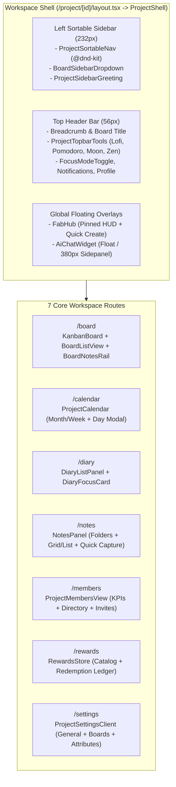

# รายงานการวิเคราะห์เชิงลึก UX/UI และโครงสร้าง Component ส่วน Workspace (`/project/[id]/*`)

**วันที่จัดทำ:** 2026-10-20  
**ขอบเขต:** ทุกหน้าย่อยภายใน Workspace (`/project/[id]/board`, `calendar`, `diary`, `notes`, `members`, `rewards`, `settings`), โครงสร้าง `ProjectShell`, ฟีเจอร์ย่อยทั้งหมด และทุก Popup / Modal / Drawer / Popover Component  
**วัตถุประสงค์:** วิเคราะห์ประสบการณ์ผู้ใช้ (UX), ความสวยงามและความสอดคล้องของอินเทอร์เฟซ (UI), จุดแข็ง, จุดบกพร่อง (Bugs/Friction Points) และแนวทางยกระดับเพื่อรองรับการพัฒนาต่อยอดในอนาคต

---

## สารบัญ (Table of Contents)

1. [ภาพรวมโครงสร้าง Workspace Architecture Map](#1-ภาพรวมโครงสร้าง-workspace-architecture-map)
2. [ส่วนที่ 1: โครงสร้างหลักของ Workspace (`ProjectShell`, Sidebar, Topbar & Floating Hubs)](#2-ส่วนที่-1-โครงสร้างหลักของ-workspace-projectshell-sidebar-topbar--floating-hubs)
3. [ส่วนที่ 2: การวิเคราะห์เจาะลึกรายหน้า (Page-by-Page UX/UI Audit)](#3-ส่วนที่-2-การวิเคราะห์เจาะลึกรายหน้า-page-by-page-uxui-audit)
   - 2.1 หน้ากระดานทำงาน (`/project/[id]/board`) — Kanban View, Table View & Notes Rail
   - 2.2 หน้าปฏิทินรวม (`/project/[id]/calendar`) — Month/Week Grid & Upcoming Rail
   - 2.3 หน้าสมุดบันทึกกิจวัตร (`/project/[id]/diary`) — Rituals Shelf & Today Checklist
   - 2.4 หน้าคลังโน้ต (`/project/[id]/notes`) — 3-Column Note Studio & Folders
   - 2.5 หน้าจัดการสมาชิก (`/project/[id]/members`) — Team Directory, Invites & Coffee Cheers
   - 2.6 หน้าร้านค้าแลกรางวัล (`/project/[id]/rewards`) — Reward Exchange & Redemption Ledger
   - 2.7 หน้าตั้งค่าโปรเจกต์ (`/project/[id]/settings`) — General, Boards, Columns & Attributes
4. [ส่วนที่ 3: การวิเคราะห์เจาะลึกทุก Popup, Modal, Drawer และ Popover (15 ชุดคอมโพเนนต์)](#4-ส่วนที่-3-การวิเคราะห์เจาะลึกทุก-popup-modal-drawer-และ-popover-15-ชุดคอมโพเนนต์)
5. [ส่วนที่ 4: ตารางสรุปลำดับความสำคัญของการปรับปรุง UX/UI (UX/UI Improvement Roadmap)](#5-ส่วนที่-4-ตารางสรุปลำดับความสำคัญของการปรับปรุง-uxui-uxui-improvement-roadmap)

---

## 1. ภาพรวมโครงสร้าง Workspace Architecture Map

---

## 2. ส่วนที่ 1: โครงสร้างหลักของ Workspace (`ProjectShell`, Sidebar, Topbar & Floating Hubs)

### ไฟล์หลักที่เกี่ยวข้อง
- [`src/app/(dashboard)/project/[id]/layout.tsx`](file:///c:/Users/Nopparat/Documents/Todo/src/app/%28dashboard%29/project/%5Bid%5D/layout.tsx)
- [`src/components/project/project-shell.tsx`](file:///c:/Users/Nopparat/Documents/Todo/src/components/project/project-shell.tsx)
- [`src/components/project/project-sortable-nav.tsx`](file:///c:/Users/Nopparat/Documents/Todo/src/components/project/project-sortable-nav.tsx)
- [`src/components/kanban/board-sidebar-dropdown.tsx`](file:///c:/Users/Nopparat/Documents/Todo/src/components/kanban/board-sidebar-dropdown.tsx)
- [`src/components/project/project-topbar-tools.tsx`](file:///c:/Users/Nopparat/Documents/Todo/src/components/project/project-topbar-tools.tsx)
- [`src/components/hub/fab-hub.tsx`](file:///c:/Users/Nopparat/Documents/Todo/src/components/hub/fab-hub.tsx)
- [`src/components/ai/ai-chat-widget.tsx`](file:///c:/Users/Nopparat/Documents/Todo/src/components/ai/ai-chat-widget.tsx)

### จุดแข็งด้าน UX/UI
1. **การจัดเรียงเมนู Sidebar ด้วยตัวเอง (`ProjectSortableNav`):** เจ้าของโปรเจกต์สามารถลากสลับลำดับเมนู (`Board`, `Calendar`, `Diary`, `Notes`, `Members`, `Rewards`, `Settings`) ได้ตามความถี่ในการใช้งาน และบันทึกค่าลงทั้ง `localStorage` และฐานข้อมูลผู้ใช้
2. **การสลับบอร์ดย่อยใน Sidebar (`BoardSidebarDropdown`):** มีช่องค้นหาบอร์ดย่อย สลับบอร์ดได้รวดเร็ว และแยกสถานะบอร์ดส่วนตัว (`Lock` icon) ชัดเจน
3. **การหลบตำแหน่งอัตโนมัติของปุ่มลอย (`FabHub` + `AiChatWidget`):** เมื่อผู้ใช้เปิด AI Assistant ในโหมด `sidepanel` (กว้าง `380px` ด้านขวา) ปุ่ม `FabHub` และการ์ด Pinned HUD จะขยับหลบไปที่ `right-[404px]` อัตโนมัติ ไม่ทับซ้อนกัน
4. **Focus Mode (`FocusModeToggle`):** กดปุ่มหรือคีย์ลัด `F` เพื่อซ่อน Sidebar และ Topbar ทั้งหมด เพิ่มพื้นที่ทำงานเต็มหน้าจอ

### จุดบกพร่องและปัญหา UX/UI ที่ตรวจพบ
1. **[CRITICAL UX BUG] เพลง Lofi ดับและเวลา Pomodoro ถูกรีเซ็ตทันทีที่ปิด Popover:**
   - ใน [`project-topbar-tools.tsx`](file:///c:/Users/Nopparat/Documents/Todo/src/components/project/project-topbar-tools.tsx) คอมโพเนนต์ `LofiPlayer` และ `NixiePomodoro` ถูกวางอยู่ภายใต้ `<PopoverContent>` ของ Radix UI (และเรนเดอร์ตามเงื่อนไขแท็บในจอ `< 2xl`)
   - ทันทีที่ผู้ใช้คลิกพื้นที่บนบอร์ดเพื่อทำงานต่อ Popover จะปิดและ **Unmount** คอมโพเนนต์ทั้งสอง
   - ใน [`lofi-player.tsx:169-175`](file:///c:/Users/Nopparat/Documents/Todo/src/components/project/lofi-player.tsx#L169-L175) มี `useEffect` cleanup ที่สั่ง `ctxRef.current.close()` ทำให้ **เสียงเพลงบรรยากาศที่เปิดไว้ดับลงทันทีที่ปิดหน้าต่างป๊อปอัป**
   - ใน [`nixie-pomodoro.tsx:68-70`](file:///c:/Users/Nopparat/Documents/Todo/src/components/project/nixie-pomodoro.tsx#L68-L70) ตัวแปร `timeLeft` และ `isRunning` อยู่ใน `useState` ภายในตัวคอมโพเนนต์ ทำให้ **เวลานับถอยหลัง Pomodoro ถูกล้างกลับเป็น 25:00 ทันทีที่ปิดป๊อปอัป**
2. **ปุ่ม `Command K` บน Topbar กดไม่ได้จริง:**
   - ใน [`project-shell.tsx:254-257`](file:///c:/Users/Nopparat/Documents/Todo/src/components/project/project-shell.tsx#L254-L257) ป้าย `Command K` เป็นเพียง `
` แสดงผลเฉยๆ (`cursor-default`) ไม่มี `onClick` เพื่อเปิด Command Palette
3. **สีโหมดสว่าง (Light Mode) เพี้ยนใน `ProjectShell` และ Studio Tools:**
   - `project-shell.tsx` ใช้คลาสสีมืดตายตัวหลายจุด เช่น ลิ้นชักมือถือ `bg-ink-950/95` (บรรทัด 97), ชื่อโปรเจกต์ `text-stone-100` (บรรทัด 138)
   - ป๊อปอัป `LofiPlayer`, `PixelMoon`, และ `NotificationsPopover` ใช้ตัวหนังสือสีขาว `text-stone-100` บนพื้นหลังสีครีมสว่างใน Light Mode ทำให้อ่านแทบไม่เห็น
4. **Topbar บนหน้าจอมือถือ (`< 640px`) แออัดและลิ้นชักเมนูไม่ปิดเอง:**
   - บนมือถือ Topbar แสดงไอคอนด้านขวาพร้อมกันกว่า 7 ปุ่ม ทำให้ชื่อโปรเจกต์ถูกบีบเหลือพื้นที่นิดเดียว และเมื่อกดเลือกเมนูใน Sidebar Drawer บนมือถือ ลิ้นชักกลับไม่หุบปิดอัตโนมัติ
5. **การสร้างงานผ่าน `FabCreateModal` ใช้ `window.location.reload()`:**
   - ใน [`fab-hub.tsx:693, 725`](file:///c:/Users/Nopparat/Documents/Todo/src/components/hub/fab-hub.tsx#L693-L725) เมื่อสร้าง Note หรือ Diary เสร็จ ระบบสั่งรีโหลดหน้าเว็บใหม่ทั้งหน้า (`window.location.reload()`) แทนที่จะใช้ `router.refresh()` พร้อมแสดง Toast

---

## 3. ส่วนที่ 2: การวิเคราะห์เจาะลึกรายหน้า (Page-by-Page UX/UI Audit)

### 2.1 หน้ากระดานทำงาน (`/project/[id]/board`)
- **ไฟล์หลัก:** [`board.tsx`](file:///c:/Users/Nopparat/Documents/Todo/src/components/kanban/board.tsx), [`board-list-view.tsx`](file:///c:/Users/Nopparat/Documents/Todo/src/components/kanban/board-list-view.tsx), [`column.tsx`](file:///c:/Users/Nopparat/Documents/Todo/src/components/kanban/column.tsx), [`card.tsx`](file:///c:/Users/Nopparat/Documents/Todo/src/components/kanban/card.tsx), [`board-view-container.tsx`](file:///c:/Users/Nopparat/Documents/Todo/src/components/kanban/board-view-container.tsx), [`board-notes-rail.tsx`](file:///c:/Users/Nopparat/Documents/Todo/src/components/notes/board-notes-rail.tsx)
- **ฟีเจอร์ปัจจุบัน:**
  - สลับมุมมอง **Kanban View** (ลากการ์ด/คอลัมน์, ปรับความกว้างคอลัมน์ `260px–600px`, พับคอลัมน์เป็นแถบแนวตั้ง, กำหนด WIP Limit) และ **Table View** (`BoardListView` รองรับแบบจัดกลุ่มตามคอลัมน์และตารางรวม, แก้ไขข้อมูล Inline, เลือกหลายรายการเพื่อเปลี่ยนสถานะ/ลบพร้อมกัน)
  - มีแผง **Board Notes Rail** (`340px`) ด้านขวาสำหรับจดโน้ตควบคู่กับการดูบอร์ด
  - รองรับ Undo (`Ctrl+Z`) หลังลากย้ายการ์ด และเอฟเฟกต์พลุฉลองเมื่อย้ายการ์ดไปที่ `DONE`
- **ปัญหา UX/UI ที่ต้องแก้ไข:**
  1. **แถบเครื่องมือซ้อนกัน 2 ชั้นในโหมด Table View (`BoardListView`):**
     - เมื่อผู้ใช้สลับจาก `Kanban` ไปเป็น `Table` แถบเครื่องมือด้านบนของ `KanbanBoard` ยังคงแสดงอยู่ครบทั้งหมด และ `BoardListView` ก็เรนเดอร์แถบเครื่องมือของตัวเองซ้อนลงมาข้างล่างอีกชั้น ทำให้มี **ช่องค้นหา (Search) 2 ช่อง**, **ตัวกรองสถานะ 2 อัน**, และ **ปุ่ม Export 2 ปุ่ม** บนหน้าจอเดียวกัน!
  2. **ปุ่มเปิด/ปิด `"Notes"` กดแล้วไม่มีอะไรเกิดขึ้นบนหน้าจอ `< 1280px` (`< xl`):**
     - ใน [`board-view-container.tsx:88`](file:///c:/Users/Nopparat/Documents/Todo/src/components/kanban/board-view-container.tsx#L88) แผง `BoardNotesRail` ถูกใส่คลาส `hidden xl:flex` แต่ปุ่ม `"Notes"` บนแถบเครื่องมือบอร์ด (`board.tsx:1388`) แสดงในทุกขนาดหน้าจอ เมื่อผู้ใช้บนโน้ตบุ๊กขนาด `1024px` หรือแท็บเล็ตกดปุ่ม `"Notes"` ปุ่มจะเปลี่ยนสีว่าเปิดอยู่ แต่ไม่มีแผงโน้ตปรากฏขึ้นมาเลย
  3. **ข้อความภาษาไทยค้างอยู่ใน Tooltip ปรับขนาดคอลัมน์ (`column.tsx:907-916`):**
     - แสดงข้อความตายตัว `"ปรับขนาดคอลัมน์ / คลิกค้างแล้วลากซ้าย-ขวาเพื่อขยาย/ย่อ"` แม้ผู้ใช้จะตั้งค่าภาษาของระบบเป็นภาษาอังกฤษ (`EN`)
  4. **การแก้ไขวันที่ใน Table View ลบเวลาเดิมทิ้งและไม่ถามยืนยัน:**
     - การแก้ Due Date แบบ Inline ใน `BoardListView` ใช้ `<input type="date">` ธรรมดา ทำให้ข้อมูลเวลา (`dueHasTime`) ที่เคยตั้งไว้ถูกล้างเป็นเที่ยงคืน และยิงอัปเดตทันทีโดยไม่ผ่าน `ConfirmModal`

---

### 2.2 หน้าปฏิทินรวม (`/project/[id]/calendar`)
- **ไฟล์หลัก:** [`project-calendar.tsx`](file:///c:/Users/Nopparat/Documents/Todo/src/components/kanban/project-calendar.tsx)
- **ฟีเจอร์ปัจจุบัน:**
  - รวมการ์ดงาน (Cards), โน้ตที่มีกำหนดส่ง (Notes), และกิจวัตรประจำวัน (Diary) มาแสดงในปฏิทินเดียว
  - สลับมุมมอง **Month** / **Week**, มีแผงตัวกรองละเอียด และแผง **Upcoming** ด้านขวา พร้อมหน้าต่าง **Day Details Modal** เมื่อคลิกที่วันใดวันหนึ่ง
- **ปัญหา UX/UI ที่ต้องแก้ไข:**
  1. **[CRITICAL BUG] การกดเลื่อนเดือนก่อนหน้า/ถัดไป (`Prev / Next`) บวก-ลบทีละ 30 วันแบบตายตัว:**
     - ใน [`project-calendar.tsx:536, 552`](file:///c:/Users/Nopparat/Documents/Todo/src/components/kanban/project-calendar.tsx#L536-L552) ปุ่มเลื่อนเดือนในโหมด Month เรียก `shiftDateKey(anchorDate, -30)` และ `+30` แทนการเลื่อนเดือนตามปฏิทินจริง!
     - หากผู้ใช้อยู่ที่วันที่ 31 มกราคม แล้วกดปุ่มเดือนถัดไป (`+30 วัน`) ปฏิทินจะกระโดดไปวันที่ 2 มีนาคม (**ข้ามเดือนกุมภาพันธ์หายไปทั้งเดือน!**)
  2. **[CRITICAL UI BUG] ตารางปฏิทินเป็นสีดำสนิทในโหมดสว่าง (Light Mode):**
     - ใน [`project-calendar.tsx:713, 731, 773`](file:///c:/Users/Nopparat/Documents/Todo/src/components/kanban/project-calendar.tsx#L713-L774) ช่องวันที่ทั้งหมดถูก Hardcode พื้นหลังเป็น `bg-[#090817]` และ `bg-[#060512]` พร้อมตัวหนังสือสีขาว ทำให้ในโหมด Warm Paper Light แถบด้านบนเป็นสีครีม แต่ตารางปฏิทินข้างล่างเป็นสีดำมืดสนิท!
  3. **มองไม่เห็นตารางกิจวัตร (Diary) ล่วงหน้าในอนาคต:**
     - บรรทัดที่ 204 (`if (day.key > todayKey) continue;`) บล็อกไม่ให้รายการ Diary ปรากฏในช่องวันพรุ่งนี้หรือสัปดาห์หน้า ทำให้ใช้วางแผนล่วงหน้าไม่ได้
  4. **ไม่สามารถกดเพิ่มงานใหม่จากช่องวันที่ได้โดยตรง:**
     - เมื่อคลิกช่องวันที่ในปฏิทิน จะเปิดได้เฉพาะหน้าต่างดูรายการของวันนั้น แต่ไม่มีปุ่ม `+ สร้างการ์ด/โน้ตในวันนี้` ที่ดึงวันที่นั้นไปใส่ให้อัตโนมัติ

---

### 2.3 หน้าสมุดบันทึกกิจวัตร (`/project/[id]/diary`)
- **ไฟล์หลัก:** [`diary-list-panel.tsx`](file:///c:/Users/Nopparat/Documents/Todo/src/components/diary/diary-list-panel.tsx), [`diary-checklist.tsx`](file:///c:/Users/Nopparat/Documents/Todo/src/components/diary/diary-checklist.tsx)
- **ฟีเจอร์ปัจจุบัน:**
  - แบ่งหน้าจอเป็น 2 ฝั่ง: ซ้ายคือชั้นวางหัวข้อกิจวัตร (`Diary Shelf`) ขวาคือรายการเช็กลิสต์ประจำวัน (`DiaryFocusCard`) พร้อมระบบตั้งรอบความถี่ซ้ำ (`ทุก N วัน` / `ทุก N เดือน`) และแจกเหรียญรางวัลเมื่อทำครบ
- **ปัญหา UX/UI ที่ต้องแก้ไข:**
  1. **[MAJOR UX GAP] ไม่มีปุ่มเลือกวันที่ (`DatePicker` หรือ `< วันก่อนหน้า / วันนี้ / วันถัดไป >`) บนหน้าจอ:**
     - แม้หน้า `DiaryPage` จะรองรับพารามิเตอร์ `?date=YYYY-MM-DD` และแสดงป้ายวันที่อยู่บนหัวการ์ด (`diary-list-panel.tsx:263`) แต่ **ไม่มีปุ่มกดเปลี่ยนวันที่เลยแม้แต่ปุ่มเดียว** ผู้ใช้ไม่สามารถย้อนไปติ๊กงานของเมื่อวานหรือดูรายการของวันพรุ่งนี้ได้ นอกจากต้องพิมพ์แก้ URL บนเบราว์เซอร์เอง
  2. **แก้ไข Diary โดยไม่ขึ้น `ConfirmModal`:**
     - มีการประกาศตัวแปร `const [isUpdateConfirmOpen, setIsUpdateConfirmOpen] = useState(false)` ไว้ที่บรรทัด 105 แต่ไม่ได้นำไปผูกกับปุ่มบันทึกหรือเรนเดอร์ Modal จริง
  3. **ขาดไฟล์ `loading.tsx`** สำหรับแสดง Skeleton ขณะสลับหน้า และใช้คลาสสีมืดตายตัวในหลายส่วน

---

### 2.4 หน้าคลังโน้ต (`/project/[id]/notes`)
- **ไฟล์หลัก:** [`notes-panel.tsx`](file:///c:/Users/Nopparat/Documents/Todo/src/components/notes/notes-panel.tsx), [`folder-modal.tsx`](file:///c:/Users/Nopparat/Documents/Todo/src/components/notes/folder-modal.tsx)
- **ฟีเจอร์ปัจจุบัน:**
  - เลยเอาต์ 3 คอลัมน์: ซ้ายคือระบบโฟลเดอร์และตัวกรองขอบเขต (`Private`, `Board`, `Project`), กลางคือกระดานโน้ตที่สลับความหนาแน่นได้ 4 แบบ (`2 คอลัมน์`, `3 คอลัมน์`, `4 คอลัมน์`, `รายการแถว`), ขวาคือช่องจดด่วน (`Quick Capture`)
- **ปัญหา UX/UI ที่ต้องแก้ไข:**
  1. **ไม่มีช่องค้นหาโน้ต (Search Input):** เมื่อผู้ใช้มีโน้ตจำนวนมาก ไม่สามารถพิมพ์ค้นหาจากชื่อหรือเนื้อหาโน้ตได้เลย (ทั้งในหน้า `/notes` และใน `BoardNotesRail`)
  2. **บนมือถือ (`< 768px`) ไม่สามารถเลือกดูหรือสร้างโฟลเดอร์ได้เลย:**
     - แถบโฟลเดอร์ด้านซ้ายถูกซ่อนด้วย `hidden md:flex` (บรรทัด 299) ส่วนแถบเมนูทดแทนบนมือถือ (บรรทัด 480) มีเพียงปุ่ม `All`, `Starred`, `Unfiled`, `Completed` เท่านั้น ทำให้ผู้ใช้บนมือถือเข้าถึงโฟลเดอร์ที่สร้างไว้ไม่ได้เลย
  3. **โค้ดซ้ำซ้อนขนาดใหญ่ (~750 บรรทัด):**
     - คอมโพเนนต์ `NoteModal` และ `EditNoteModal` ถูกคัดลอกวางซ้ำกันทั้งใน `notes-panel.tsx` และ `board-notes-rail.tsx`

---

### 2.5 หน้าจัดการสมาชิก (`/project/[id]/members`)
- **ไฟล์หลัก:** [`project-members-view.tsx`](file:///c:/Users/Nopparat/Documents/Todo/src/components/project/project-members-view.tsx)
- **ฟีเจอร์ปัจจุบัน:**
  - แสดงการ์ดสถิติ 5 ช่องที่คลิกเพื่อกรองรายชื่อได้ทันที (`Total Members`, `Workspace Owners`, `Project Members`, `Pending Invites`, `Total Coffees`) พร้อมตารางจัดการสมาชิก คำเชิญที่รอดำเนินการ และตารางเปรียบเทียบสิทธิ์
- **จุดแข็ง:** เป็นหน้าที่ทำสีรองรับทั้ง Light Mode และ Dark Mode ได้สมบูรณ์ที่สุดใน Workspace และมี `ConfirmModal` ครบทุกการกระทำ
- **ปัญหา UX/UI ที่ต้องแก้ไข:**
  - ปุ่มหลัก `"Invite Teammate"` บนหัวหน้าจอ (บรรทัด 403) แสดงให้สมาชิกทั่วไป (`MEMBER`) กดเปิดหน้าต่างกรอกอีเมลได้ ทั้งที่สิทธิ์การเชิญควรจำกัดเฉพาะเจ้าของ/ผู้ดูแล

---

### 2.6 หน้าร้านค้าแลกรางวัล (`/project/[id]/rewards`)
- **ไฟล์หลัก:** [`rewards-store.tsx`](file:///c:/Users/Nopparat/Documents/Todo/src/components/project/rewards-store.tsx)
- **ฟีเจอร์ปัจจุบัน:**
  - แสดงยอดเหรียญ (`Global Coins` & `Project Coins`), รายการของรางวัลพร้อมปุ่มกดเพิ่มรางวัลเริ่มต้น 5 รายการในคลิกเดียว (`Starter Rewards`), และแผงประวัติการแลกรางวัล (`Redemption Ledger`) ด้านขวาให้ Admin กดอนุมัติหรือปฏิเสธ
- **ปัญหา UX/UI ที่ต้องแก้ไข:**
  1. **ไม่มีปุ่มแก้ไข (Edit) หรือลบ (Delete) ของรางวัลที่สร้างไปแล้ว:**
     - เมื่อสร้างของรางวัลหรือกดเพิ่ม Starter Rewards ไปแล้ว การ์ดของรางวัลไม่มีปุ่มแก้ไขราคา/ชื่อ หรือปุ่มลบทิ้งเลย หากพิมพ์ผิดหรือต้องการปรับราคาจะไม่สามารถแก้ไขได้
  2. **ข้อความปนภาษาอังกฤษ-ไทยแบบตายตัว (Hardcoded Bilingual Text):**
     - เช่น `"Reward Exchange · แลกของรางวัลและความสำเร็จ"`, `"Add All 5 Starter Rewards (คลิกเดียวเพิ่มทั้งหมด)"` ซึ่งไม่เปลี่ยนตามตัวสลับภาษาของแอป
  3. **ตัวสลับโปรเจกต์ภายในหน้า Rewards ทำให้บริบทไม่ตรงกับ Sidebar:**
     - เมื่ออยู่ใน `/project/A/rewards` แล้วเปลี่ยน Dropdown บนแบนเนอร์ไปดู Project B ข้อมูลร้านค้าจะเปลี่ยนเป็นของ Project B แต่ URL และเมนู Sidebar ด้านซ้ายยังค้างอยู่ที่ Project A

---

### 2.7 หน้าตั้งค่าโปรเจกต์ (`/project/[id]/settings`)
- **ไฟล์หลัก:** [`project-settings-client.tsx`](file:///c:/Users/Nopparat/Documents/Todo/src/components/project/project-settings-client.tsx), [`project-boards-manager.tsx`](file:///c:/Users/Nopparat/Documents/Todo/src/components/project/project-boards-manager.tsx), [`settings-form.tsx`](file:///c:/Users/Nopparat/Documents/Todo/src/components/project/settings-form.tsx)
- **ฟีเจอร์ปัจจุบัน:**
  - ศูนย์รวมการตั้งค่าระดับโปรเจกต์และบอร์ดย่อย แบ่งเป็นหมวด `Project` (General, Members), `Boards` (All boards, Board details, Columns, Card attributes), และ `Personal` (Theme & sound) พร้อมการซิงค์สถานะแท็บไว้ใน URL (`?tab=...&boardId=...`)
- **ปัญหา UX/UI ที่ต้องแก้ไข:**
  1. **แถบ Header ซ้อนทับกับ `ProjectShell`:** เมนูซ้ายของหน้า Settings แสดงปุ่ม `"Back to board"` และกล่องชื่อโปรเจกต์ซ้ำกับ Sidebar หลักของ `ProjectShell` ที่อยู่ติดกันทางซ้ายมือ
  2. **สีของ `ProjectBoardsManager` ในโหมดสว่าง:** ในขณะที่ `project-settings-client.tsx` ใช้ตัวแปรสีธีม (`text-theme-foreground`) อย่างถูกต้อง แต่ `project-boards-manager.tsx` ยังใช้ `text-stone-100` และ `border-white/10` แบบตายตัว

---

## 4. ส่วนที่ 3: การวิเคราะห์เจาะลึกทุก Popup, Modal, Drawer และ Popover (15 ชุดคอมโพเนนต์)

| ลำดับ | ชื่อ Component & ไฟล์ | หน้าที่หลัก | จุดแข็ง (Strengths) | จุดบกพร่อง / สิ่งที่ต้องปรับปรุง (Flaws & Fixes) |
| :---: | :--- | :--- | :--- | :--- |
| **1** | **`CardModal` & `DraftRecoveryModal`** [`card-modal.tsx`](file:///c:/Users/Nopparat/Documents/Todo/src/components/kanban/card-modal.tsx) | หน้าต่างสร้าง/แก้ไขการ์ดงานขนาดใหญ่ (`max-w-4xl` 2 คอลัมน์) | มีระบบเซฟ Draft อัตโนมัติลง `localStorage` พร้อมหน้าต่างกู้คืน, แจ้งเตือนเมื่อมีคนอื่นแก้การ์ดพร้อมกัน, ลากสลับ Checklist ได้ | 1. ถูกเรนเดอร์ซ้ำในทุกๆ `KanbanColumn` (รัน Hooks ตลอดเวลาแม้ไม่ได้เปิด) 2. บนจอมือถือ (`< lg`) เนื้อหายาวมากต้องเลื่อนขึ้นลงไกล (ควรใช้แท็บย่อยบนมือถือ) 3. บางส่วนยัง Hardcode สีมืด `text-stone-200` |
| **2** | **`CardAttributesEditModal`** [`card-attributes-edit-modal.tsx`](file:///c:/Users/Nopparat/Documents/Todo/src/components/kanban/card-attributes-edit-modal.tsx) | หน้าต่างแก้ไข Status, Priority, Story Points ที่เปิดซ้อนจาก `CardModal` (`z-[1150]`) | แก้ไขตัวเลือกสถานะได้ทันทีโดยไม่ต้องออกจากหน้าการ์ด | **[CRITICAL Z-INDEX BUG]** เมื่อกดปุ่ม `"Save as Custom Template"` ภายในหน้าต่างนี้ Modal ย่อยถูกเรนเดอร์ด้วย `z-50` (`board-priorities-tab.tsx:732`, `board-attributes-tab.tsx:1824`) ทำให้ **จมอยู่ข้างหลัง `CardAttributesEditModal` (`z-[1150]`) มองไม่เห็นและกดไม่ได้!** |
| **3** | **`AiBreakdownModal`** [`ai-breakdown-modal.tsx`](file:///c:/Users/Nopparat/Documents/Todo/src/components/ai/ai-breakdown-modal.tsx) | วิซาร์ด 2 ขั้นตอนให้ AI แตกงานย่อยลง Checklist (`1 cr`) | มีหน้า Preview ให้แก้ไข/ลบรายการย่อยก่อนกดนำไปใช้จริง และเลือก Append หรือ Replace ได้ | พื้นหลังและตัวอักษร Hardcode เป็นโหมดมืด (`bg-ink-950/95 text-stone-100`) ไม่เปลี่ยนตาม Light Mode |
| **4** | **`AiProjectSummaryModal`** [`ai-project-summary-modal.tsx`](file:///c:/Users/Nopparat/Documents/Todo/src/components/ai/ai-project-summary-modal.tsx) | ให้ AI วิเคราะห์สุขภาพบอร์ด สรุปคอขวด และบันทึกเป็นโน้ต (`2 cr`) | แสดงระดับสุขภาพบอร์ด (`HEALTHY / ATTENTION / CRITICAL`) ชัดเจน และกดบันทึกเข้าคลังโน้ตได้ในคลิกเดียว | **[UX FLAW]** ทันทีที่เปิด Modal ระบบยิง API **หักเครดิต AI 2 เครดิตทันทีใน `useEffect`** โดยไม่ถามยืนยันจากผู้ใช้ก่อน (ควรมีปุ่มกดยืนยันเหมือน `AiBreakdownModal`) |
| **5** | **`BoardExportModal` & `BoardExportButton`** [`board-export-modal.tsx`](file:///c:/Users/Nopparat/Documents/Todo/src/components/kanban/board-export-modal.tsx) | ส่งออกบอร์ดเป็น PDF, PNG, Excel, CSV พร้อมพรีวิวแบบสด | รองรับทั้งรูปแบบกระดานพาโนรามาและตารางรายงานผู้บริหาร เลือกธีมสว่าง/มืดของไฟล์ส่งออกได้ | **[PERF BUG]** `BoardExportButton` เรนเดอร์ DOM ของบอร์ดทั้งหมดซ่อนไว้นอกจอ (`left: -99999px`) ตลอดเวลาแม้ไม่ได้กดใช้งาน ทำให้หน้าบอร์ดแบก DOM เป็น 2–3 เท่า |
| **6** | **`BoardActivityDrawer`** [`board-activity-drawer.tsx`](file:///c:/Users/Nopparat/Documents/Todo/src/components/kanban/board-activity-drawer.tsx) | ลิ้นชักด้านขวาแสดงประวัติความเคลื่อนไหวของบอร์ด | กรองตามประเภทกิจกรรมได้ (`Create, Move, Update, Delete, Archive`) และมี `ConfirmModal` ก่อนล้างประวัติ | ถูกซ่อนไว้ลึกในปุ่มเมนู `...` (`MoreHorizontal`) และแสดงได้เฉพาะบนโหมดมุมมอง Kanban เท่านั้น |
| **7** | **`ArchivedCardsModal`** [`archived-cards-modal.tsx`](file:///c:/Users/Nopparat/Documents/Todo/src/components/kanban/archived-cards-modal.tsx) | หน้าต่างจัดการการ์ดที่ถูกเก็บเข้าคลัง (Archive) | ค้นหาการ์ดในคลังได้รวดเร็ว และมี `ConfirmModal` ก่อนลบถาวร | ปุ่ม `Restore to Board` กดแล้วยิง API กู้คืนทันทีโดยไม่แสดง `ConfirmModal` |
| **8** | **`BoardSettingsModal`** [`board-settings-modal.tsx`](file:///c:/Users/Nopparat/Documents/Todo/src/components/kanban/board-settings-modal.tsx) | หน้าต่างตั้งค่าบอร์ด 4 แท็บ (`General`, `Columns`, `Card Attributes`, `Danger Zone`) | มีพรีวิวการ์ดจำลองแบบสดขณะปรับแต่งสถานะและระดับความสำคัญ | ไฟล์แท็บย่อยมีขนาดใหญ่มาก (`board-attributes-tab.tsx` 1,895 บรรทัด) และไม่ได้แยกโหลดด้วย `next/dynamic` |
| **9** | **`CreateBoardModal`** [`create-board-modal.tsx`](file:///c:/Users/Nopparat/Documents/Todo/src/components/kanban/create-board-modal.tsx) | หน้าต่างสร้างบอร์ดใหม่พร้อม 5 เทมเพลตมาตรฐาน | แสดงแผนผัง Pipeline ของคอลัมน์เข้าใจง่าย และใช้ตัวแปรสีธีม (`bg-theme-panel`) ได้อย่างสมบูรณ์ | — |
| **10** | **Column Create/Edit Modals** [`board.tsx`](file:///c:/Users/Nopparat/Documents/Todo/src/components/kanban/board.tsx), [`column.tsx`](file:///c:/Users/Nopparat/Documents/Todo/src/components/kanban/column.tsx) | หน้าต่างสร้างและแก้ไขคอลัมน์ (ชื่อ, สี, ไอคอน 24 แบบ, WIP Limit, สถานะที่ผูก) | สามารถกด `+ Add Status` สร้างสถานะใหม่ได้จากในหน้าต่างแก้ไขคอลัมน์โดยตรง | การบันทึกแก้ไขคอลัมน์จากใน `column.tsx` ไม่ได้ผ่าน `ConfirmModal` (ไม่ตรงกับหน้า Settings ที่มี `ConfirmModal`) |
| **11** | **Calendar Day Details & Note Preview Modals** [`project-calendar.tsx`](file:///c:/Users/Nopparat/Documents/Todo/src/components/kanban/project-calendar.tsx) | หน้าต่างดูรายละเอียดงานทั้งหมดในวันที่คลิกเลือก | มีวงแหวน SVG แสดงเปอร์เซ็นต์งานที่เสร็จในวันนั้น และกดติ๊กเสร็จได้จากในหน้าต่างทันที | ไม่มีปุ่ม `+ เพิ่มงานในวันนี้` และใช้สีพื้นหลังมืดตายตัว (`bg-[#0d0c1d]`) |
| **12** | **`DiaryItemModal`** [`diary-list-panel.tsx`](file:///c:/Users/Nopparat/Documents/Todo/src/components/diary/diary-list-panel.tsx) | หน้าต่างสร้าง/แก้ไขกิจวัตรประจำวัน (`max-w-5xl` 2 คอลัมน์) | ตั้งค่ารอบวันซ้ำและรางวัลเหรียญได้ละเอียดในหน้าจอเดียว | ตัวแปร `isUpdateConfirmOpen` ไม่ได้ถูกนำมาเรนเดอร์จริง ทำให้การแก้ไขไม่ถามยืนยัน |
| **13** | **`NoteModal`, `EditNoteModal` & `FolderModal`** [`notes-panel.tsx`](file:///c:/Users/Nopparat/Documents/Todo/src/components/notes/notes-panel.tsx), [`folder-modal.tsx`](file:///c:/Users/Nopparat/Documents/Todo/src/components/notes/folder-modal.tsx) | หน้าต่างสร้าง/แก้ไขโน้ตและโฟลเดอร์ | เลือกสติกเกอร์เรโทรได้กว่า 30 แบบ และตั้งค่าการมองเห็นได้ 3 ระดับ | โค้ด `NoteModal` และ `EditNoteModal` ถูกเขียนซ้ำกัน 2 ไฟล์ (~750 บรรทัด) ควรยุบรวมเป็น Shared Component เดียว |
| **14** | **`NotificationsPopover` & `InvitationConfirmModal`** [`notifications-popover.tsx`](file:///c:/Users/Nopparat/Documents/Todo/src/components/notifications/notifications-popover.tsx) | ป๊อปอัปกระดิ่งแจ้งเตือน คำเชิญเข้าโปรเจกต์ และส่งแก้วกาแฟกลับ (`Cheers back`) | กดตอบรับคำเชิญหรือส่งกาแฟขอบคุณกลับได้ทันทีจากในป๊อปอัปพร้อม `InvitationConfirmModal` | ใช้พื้นหลังมืดตายตัว `bg-ink-950/95` ในโหมดสว่าง |
| **15** | **`UserProfilePopover`** [`user-profile-popover.tsx`](file:///c:/Users/Nopparat/Documents/Todo/src/components/project/user-profile-popover.tsx) | ป๊อปอัปโปรไฟล์ ยอดเหรียญ โควตา AI และสลับธีม/เสียง | รวมศูนย์ข้อมูลเหรียญ โควตา AI การสลับธีม Light/Dark และเปิด/ปิดเสียงเอฟเฟกต์ไว้ครบจบในที่เดียว | ปุ่มเปลี่ยนภาษา (`LanguageSwitcher`) ซ้ำกับปุ่มที่อยู่บน Topbar ด้านนอก |

---

## 5. ส่วนที่ 4: ตารางสรุปลำดับความสำคัญของการปรับปรุง UX/UI (UX/UI Improvement Roadmap)

| ลำดับความสำคัญ | หมวดหมู่ | รายการแก้ไข (Actionable Fixes) |
| :---: | :--- | :--- |
| **P0 (เร่งด่วนที่สุด)** | **Functional UX Bugs** | 1. **แยก State/Audio ของ `LofiPlayer` และ `NixiePomodoro`** ไม่ให้ถูกทำลายเมื่อปิด Popover บน Topbar 2. **แก้สูตรเลื่อนเดือนใน `ProjectCalendar`** จาก `±30 วัน` เป็นการเลื่อนเดือนตามปฏิทินจริง (`new Date(year, month ± 1, 1)`) 3. **เพิ่มตัวเลือกวันที่ (`DatePicker` + ปุ่ม `< วันก่อนหน้า | วันนี้ | วันถัดไป >`)** ในหน้า `/project/[id]/diary` 4. **แก้ `z-index` ของ Modal ย่อยบันทึกเทมเพลต** ใน `board-attributes-tab.tsx` และ `board-priorities-tab.tsx` ให้สูงกว่า `CardAttributesEditModal` (`z-[1200]`) |
| **P1 (สำคัญสูง)** | **Visual & Layout Consistency** | 1. **ยุบรวมแถบเครื่องมือที่ซ้อนกัน 2 ชั้นในโหมด Table View (`BoardListView`)** ให้ใช้แถบค้นหา/ตัวกรอง/ปุ่ม Export ร่วมกับ `KanbanBoard` เพียงชุดเดียว 2. **แก้ไขตาราง `ProjectCalendar` ในโหมดสว่าง (Light Mode)** ไม่ให้เป็นพื้นหลังสีดำสนิท 3. **เพิ่มปุ่มแก้ไขและลบของรางวัล (Edit/Delete Reward)** สำหรับ Admin ในหน้า `/project/[id]/rewards` 4. **แก้ปุ่ม `"Notes"` บนบอร์ดสำหรับหน้าจอ `< xl`** ให้เปิดเป็น Slide-over Drawer แทนการกดแล้วไม่เกิดอะไรขึ้น |
| **P2 (ยกระดับประสบการณ์)** | **Polish & Code Hygiene** | 1. **เพิ่มช่องค้นหาโน้ต (Search Notes)** และตัวเลือกโฟลเดอร์บนมือถือในหน้า `/project/[id]/notes` 2. **ยุบรวม `NoteModal` / `EditNoteModal`** ที่ซ้ำกันระหว่าง `notes-panel.tsx` และ `board-notes-rail.tsx` เข้าเป็นไฟล์กลาง 3. **ให้ `AiProjectSummaryModal` แสดงปุ่มยืนยันก่อนหัก 2 AI Credits** และเปลี่ยน `window.location.reload()` ใน `FabCreateModal` เป็น `router.refresh()` 4. **ผูกปุ่ม `Command K` บน Topbar** ให้เปิด `CommandPalette` ได้จริง และปิด Drawer มือถืออัตโนมัติเมื่อกดเปลี่ยนหน้า |
